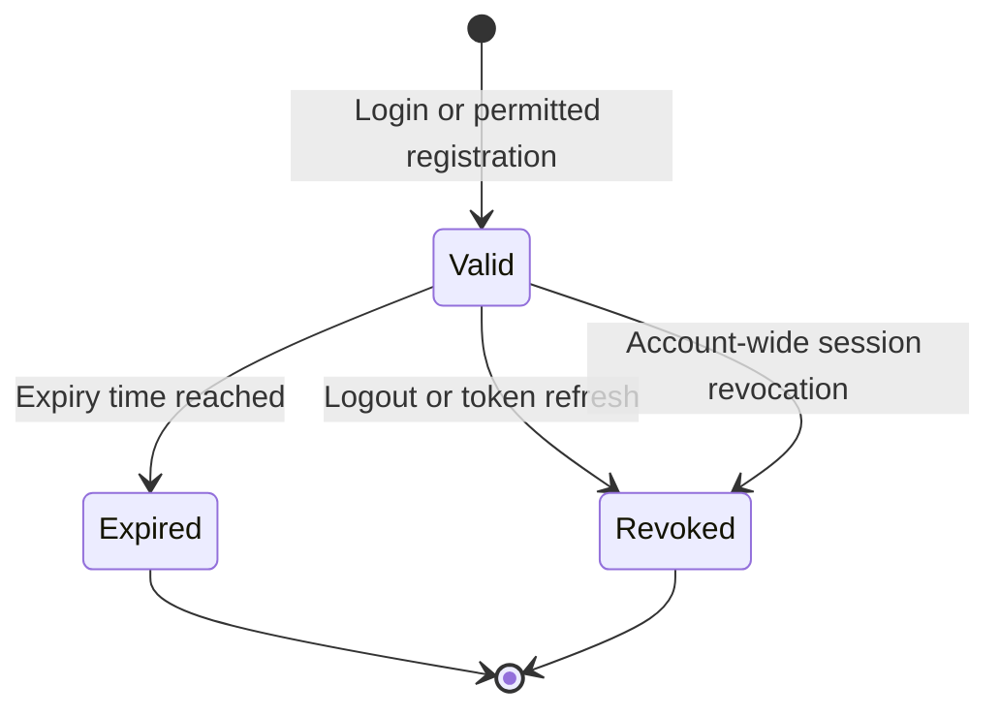

# Authentication

Magpie uses JWT bearer tokens to authenticate accounts. The token proves who
is making a request; workspace membership determines which operational resources
that account may access.

## Get and send a token

`POST /api/login` accepts an email/password JSON body and returns a `token`
and global `role`. Registration can also return a token when policy permits
account creation. See [auth payloads](rest-auth-and-user.md).

Send the token in a header on every protected request:

```http
Authorization: Bearer <token>
X-Workspace-ID: 42
```

Do not put it in a URL. Missing, malformed, expired, invalid, or revoked tokens
can return `401`. The [first API workflow](rest-overview.md#first-authenticated-workflow)
shows workspace discovery and a read request.

## Token lifecycle



| Endpoint | Effect |
| --- | --- |
| `GET /api/checkLogin` | Validate the supplied token; returns 200 with no useful payload. |
| `POST /api/refreshToken` | Return a new token and revoke the old one. Replace the stored token after success. |
| `POST /api/logout` | Revoke the supplied token; returns 204. |
| Password change/reset or account deletion | Revoke account sessions under the configured revocation-store policy. |

Coordinate refresh in clients that make concurrent requests. Requests still
using the old token can fail once refresh revokes it. Do not repeatedly refresh
an already revoked token.

JWTs use HS256 and include `user_id`, global `role`, `exp`, `iat`, and `jti`.
`JWT_TTL_MINUTES` defaults to 10080, seven days, with an allowed range of
15-10080 minutes.

## Workspace header

`X-Workspace-ID` selects a workspace on resource requests. Omission uses the
account's default membership. A valid ID does not grant access, and a global
administrator still needs membership. Workspace-management paths authorize
against their `{id}` value instead. See [workspace API](rest-workspaces.md).

| Protection | Required access |
| --- | --- |
| `RequireAuth` | Valid account JWT. |
| `IsAdmin` | Valid JWT with global `role=admin`. |
| `withWorkspaceViewer` | Membership with viewer or higher access. |
| `withWorkspaceOperator` | Membership with operator or higher access. |

Route registration applies these checks in the backend's
[`routes.go`](https://github.com/Magpie-Tools/magpie-backend/blob/main/internal/app/server/routes.go).
Other workspace handlers enforce their role-specific rules in the handler.

## Revocation behavior

Revocation uses token IDs and account-wide revoke cutoffs stored in Redis.
By default, `AUTH_REVOCATION_FAIL_OPEN=true` allows an otherwise valid signed,
unexpired token when the revocation store is unavailable. That can prevent
revocations from being enforced during an outage. With `false`, that outage
causes strict authentication failures.

Choose and document the outage policy for the deployment. The production
Compose overlay does not automatically set every optional auth variable;
[pass backend variables explicitly](../reference/environment-variables.md#apply-a-setting)
when needed.

## Signing-key continuity

Installers save a generated `JWT_SECRET` in `.env`. When it is empty, the
backend generates `/app/data/jwt_secret` and reuses that file from the backend
data volume. Multi-instance deployments need one shared explicit signing key.

A changed or lost signing key invalidates older tokens. Preserve it in
[backups](../operations/backup-and-recovery.md), together with the stable
`PROXY_ENCRYPTION_KEY` used for other protected data. These keys serve different
purposes.

## Password recovery

Forgot-password and reset-password are public, rate-limited endpoints.
Reset tokens are short-lived, single-use, and stored only as hashes.
`PUBLIC_APP_URL` supplies the link origin. Accepted reset requests return a
generic message; actual email requires configured outbound delivery.
See [account recovery](../user-guide/account.md#recover-a-forgotten-password).

## Workspace invitation authentication

Invitations belong to an existing recipient account. Their emails link to
`/invitations` without an acceptance token. The recipient signs in normally
to list, accept, or decline the offer. Existing workspace membership is not
required to use that inbox; the invitation grants membership only on acceptance.

Managing outgoing invitations requires the appropriate role in the workspace
path. [Workspace roles](../user-guide/workspaces.md#roles) explain the limits.

## GraphQL authentication

`POST /api/graphql` uses the same bearer token and workspace selection.
Queries require viewer or higher membership; settings mutations require
operator or higher. Authentication and guards can fail before the resolver
runs. Resolver errors use the GraphQL response envelope instead of the ordinary
REST error object. See [GraphQL](graphql.md#error-format).
