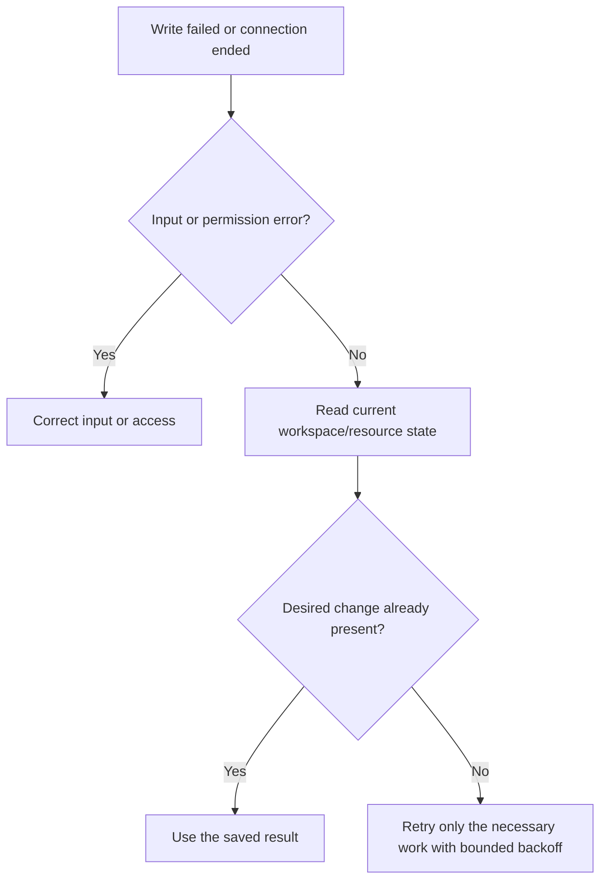

# Error handling

Check the HTTP status, response content type, and body before deciding what to
retry. Magpie retains several response formats for compatibility. A client
that assumes every response is a JSON object will mishandle plain-text auth
errors, empty responses, and JSON strings.

## JSON object error format

Most handlers return:

```json
{"error": "message"}
```

Some validation responses add useful metadata:

| Failure | Additional fields |
| --- | --- |
| Blocked URLs in global configuration | `blocked_websites`, `website_blacklist`. |
| Blocked or unsafe scrape-source upload | `blocked_sources`, `unsafe_sources`, `websiteBlacklist`. |
| Blocked workspace judge URL | `blocked_websites`. |

Read the specific endpoint reference before depending on those fields. Keep
unknown fields compatible with newer server versions.

## Plain-text auth errors

Auth middleware can return plain-text `401` or `403` errors. Inspect the
response's content type before calling a JSON decoder. Show the supplied
message without assuming it has an `error` property.

## Status and next action

| Status | First action | Retry guidance |
| --- | --- | --- |
| `400` | Correct payload, enum, parameter, or validation rule. | Retry after correcting input. |
| `401` | Check token expiry, revocation, and current signing key. | Sign in or use the replacement token. |
| `403` | Check workspace membership/role, global role, CORS, or probe protection. | More attempts do not add permission. |
| `404` | Verify the ID and selected workspace. | Refresh discovery data before recreating resources. |
| `409` | Resolve a duplicate, capacity limit, protected ownership state, or empty pool. | Inspect current state first. |
| `410` | An invitation expired before cleanup removed its row. | Request a new invitation if access is still needed. |
| `413` | Reduce upload, JSON body, or query size. | Split the work or reduce fields. |
| `429` | Read `Retry-After`. | Wait; avoid synchronized retry loops. |
| `500`, `503` | Inspect dependency errors and current resource state. | Retry with bounded backoff when appropriate. Check mutation outcomes first. |

## Retrying a mutation



An upload is not necessarily one transaction. Earlier proxy batches can remain
committed after a later failure. Bulk deletion also commits batches. A lifecycle
change can commit before queue synchronization returns `503`. Retrying without
checking state can therefore repeat already completed work.

Creation endpoints do not offer a general idempotency-key contract. Discover
existing resources and use endpoint-specific conflict responses. When a
mutation's final response is lost, a network error alone cannot prove rollback.

## String responses that are not error objects

Some actions return JSON strings, for example:

```json
"Deleted 25 proxies."
```

`"No proxies matched the delete criteria."` can also be a successful result.
Interpret these using HTTP status and the endpoint contract, not by whether
the body contains an `error` property. A `204` response has no body to decode.

## GraphQL errors

A GraphQL resolver can return HTTP 200 with an `errors` array and possibly
partial `data`. Check that array as well as the HTTP status. Authentication,
body limits, and query guards can reject a request earlier with REST-style
HTTP errors. See [GraphQL error format](graphql.md#error-format).

## Export failures

A successful response status received before a streaming export completes does
not prove the file is complete. Treat an interrupted or failed transfer as a
failed export and retry a smaller selection if needed. Canceling the request
cancels its database work. See [proxy export](rest-auth-and-user.md#post-apiuserexport).

For server-side diagnosis, use [troubleshooting](../operations/troubleshooting.md).
