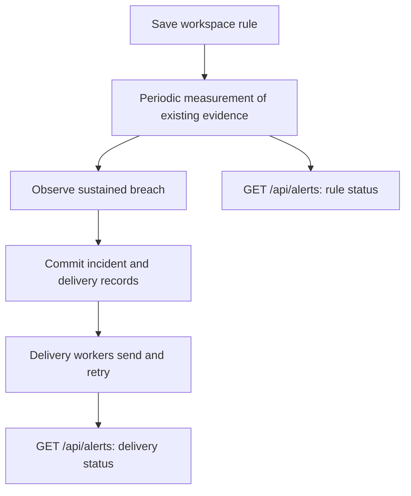

# Alerts API

Alert rules, destinations, incidents, and deliveries belong to the selected
workspace. Send a bearer token and `X-Workspace-ID`, or use the account's
default membership. Global administrator status alone does not grant access.

## Build an alert integration

1. Read scope metadata from `GET /api/alerts/rotators` if monitoring a rotator.
2. Create a rule without destinations to verify its scope and measurements.
3. As a workspace admin or owner, create a destination and retain its returned ID.
4. Replace the rule configuration with the desired `destination_ids`.
5. Read `/api/alerts` for evaluation, incidents, and separate delivery outcomes.

Creating or editing a rule does not synchronously evaluate it or send a test
message. Evaluation follows the fixed [alert policy](../user-guide/alerts.md).



## Endpoints and permissions

| Endpoint | Minimum workspace role | Success |
| --- | --- | --- |
| `GET /api/alerts` | Viewer | 200, rules and a history page. |
| `GET /api/alerts/rotators` | Viewer | 200, scope metadata array. |
| `POST /api/alerts/rules` | Operator | 201, saved rule. |
| `PUT /api/alerts/rules/{id}` | Operator | 200, saved rule. |
| `DELETE /api/alerts/rules/{id}` | Operator | 204. |
| `POST /api/alerts/destinations` | Admin | 201, saved destination metadata. |
| `PUT /api/alerts/destinations/{id}` | Admin | 200, saved destination metadata. |
| `DELETE /api/alerts/destinations/{id}` | Admin | 204. |
| `POST /api/alerts/deliveries/{id}/retry` | Admin | 204. |

Invalid configuration returns 400, insufficient role returns 403, and an
unknown resource in this workspace returns 404. A destination from another
workspace cannot be attached to a rule.

## Read rules and history

`GET /api/alerts` returns `rules`, `destinations`, `incidents`, `deliveries`,
and `next_cursor`. Each page contains the most recent 50 incidents in descending
ID order and their deliveries. Request `?before={next_cursor}` for older
incidents. Stop when the cursor is zero; a final full page can lead to one
additional empty page.

Rules expose `revision`, `status`, `last_value`, `sample_count`,
`last_evaluated_at`, `breach_since`, `recovery_since`, and `active_incident_id`.

| Value | Interpretation |
| --- | --- |
| `healthy` | Latest known measurement does not breach. An existing incident can still be waiting for sustained recovery. |
| `breaching` | Latest measurement breaches. An incident opens only after the sustained-breach requirement. |
| `unknown` | No usable measurement or too few samples. Does not prove recovery. |
| `disabled` | Rule is not being evaluated. |
| Null `last_value` | No current measurement value. |

An active incident can remain open while status is unknown or recovery is
pending. Incidents retain the `rule_revision` that opened them.

Destination reads expose `id`, `name`, `kind`, `enabled`, `target_configured`,
`signing_configured`, `mention_mode`, and `mention_id`. Targets and signing
secrets are write-only. Delivery records contain status and a sanitized error,
not the target or saved payload.

`GET /api/alerts/rotators` returns scope metadata such as:

```json
[{"id":12,"name":"Production HTTP pool","protocol":"http"}]
```

It reads IDs, names, and upstream protocols only, without calculating pool
counts or returning credentials. Clients can load it independently of incident
pagination, as the frontend does.

## Save a rule

POST creates a rule; PUT replaces its complete configuration:

```json
{
  "name": "Minimum usable routes",
  "rotator_id": 12,
  "metric": "usable_routes",
  "threshold": 50,
  "enabled": true,
  "destination_ids": [3, 4]
}
```

Use IDs from the selected workspace. Set `rotator_id: null` for the whole
workspace and `destination_ids: []` to record incidents without messages.
Names are required and limited to 120 UTF-8 bytes.

| Metric | Threshold | Breach |
| --- | --- | --- |
| `usable_routes` | Whole number 1-1,000,000,000 | Count below the minimum. |
| `success_rate` | Percentage 0-100 | Checker success rate below the minimum. |
| `latency_ms` | Positive number at most 65535 | Average successful-check latency above the maximum. |

Checker success and latency measure attributed checks in a 15-minute window,
not client traffic. Pool counts follow current eligibility. The
[user guide](../user-guide/alerts.md#choose-a-condition) explains the different
scopes, sample minimums, and two-minute breach/recovery periods.

Editing or deleting a rule closes an open incident as `configuration_changed`,
cancels queued messages, and resets evaluation. DELETE retains incident history.
Deleting a rotator disables its rules; repair their scope before enabling them.
Deleting a destination leaves its ID in existing rules for historical reference;
omit that missing ID when editing a rule.

## Save a destination

Create with POST and update with PUT:

```json
{
  "name": "Operations webhook",
  "kind": "webhook",
  "enabled": true,
  "target": "https://ops.example.test/magpie-alerts",
  "signing_secret": "replace-with-your-shared-secret"
}
```

The target and secret are placeholders. A destination's kind cannot change
on update; create a new destination to switch channels.

| Field | Behavior |
| --- | --- |
| `kind` | `email`, `slack`, `discord`, or `webhook`. |
| `target` | Required on creation. Omit on update to retain the saved target. |
| `signing_secret` | Generic webhooks only. Omit to retain; an empty string clears it. |
| `enabled` | Controls whether it can deliver messages. |
| `mention_mode`, `mention_id` | Optional chat audience. Omit both on update to retain saved settings. |

Targets and secrets accept at most 4096 bytes. An email target is one plain
address with at most 254 bytes. Slack/Discord targets use their supported
incoming webhook URLs. Generic webhooks use HTTPS under the default outbound
policy; private destinations require the deployment's explicit egress override.
Changing or disabling a destination cancels its queued messages; in-flight
requests can still finish.

### Chat mentions

| Channel | Modes | ID when required |
| --- | --- | --- |
| Discord | `none`, `here`, `everyone`, `role` | Numeric role ID as a string for `role`. |
| Slack | `none`, `here`, `channel`, `everyone`, `user_group` | Group ID beginning with `S` for `user_group`. |
| Email/webhook | `none` | No mention ID. |

New destinations default to `none`. Modes that do not use an ID clear a saved
ID. Mention changes cancel queued messages, just like target changes. The
[user guide](../user-guide/alerts.md#optional-chat-mentions) explains provider
permissions and delivery appearance.

## Retry a delivery

`POST /api/alerts/deliveries/{id}/retry` takes an empty body. Only the latest
failed delivery for an enabled destination and the current rule revision can
be retried. Editing or deleting the rule prevents retrying earlier messages.
A newer event for the same incident/destination also prevents replaying the
older event. Invalid retries return 400.

Delivery is at least once. Webhook receivers should deduplicate using
`X-Magpie-Delivery-ID` and verify the signature when configured. See
[webhook payloads and signatures](../user-guide/alerts.md#generic-webhook-payload).
