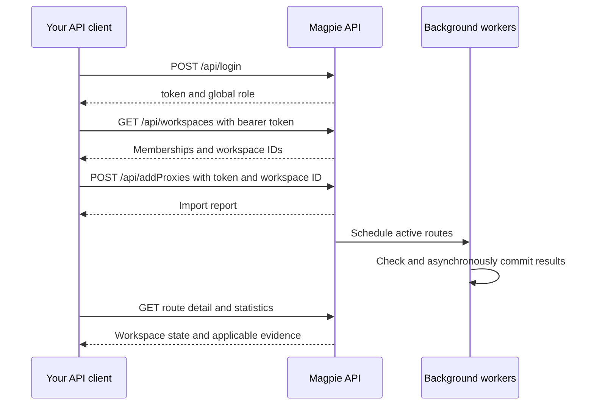

# REST API overview

Use REST to automate the same workspace resources available in the dashboard.
Start with authentication and workspace discovery, then operate on the returned
IDs. A route's existence, check health, and rotator eligibility are separate
states in API responses too.

## Base URLs

In the default stack, use either the frontend's same-origin API at
`http://localhost:5050/api` or the direct loopback backend at
`http://127.0.0.1:5656/api`. In a deployed instance, use its configured public
HTTPS origin. Examples in endpoint headings include `/api` already.

Observability endpoints are at the backend root: `/healthz`, `/readyz`, and
`/metrics`. They have separate access protection and are not under `/api`.

## First authenticated workflow



1. Send `POST /api/login` with your account's email and password as JSON.
   Copy the returned token into your client's bearer-token configuration.
2. Send `GET /api/workspaces` and choose an ID from your memberships.
3. Send `X-Workspace-ID` on resource requests so an account-default change
   cannot silently redirect your automation to another workspace.
4. Start with a read such as `GET /api/getProxyPage/1?pageSize=20`.
5. For writes, check the endpoint's required workspace role. Import accepts
   multipart data; a successful import is followed by asynchronous checking.

A read request has this shape:

```http
GET /api/getProxyPage/1?pageSize=20
Authorization: Bearer <token-from-login>
X-Workspace-ID: 42
```

For Bash/curl examples on the reference pages, define the base origin and read
your token without echoing it into the terminal. Choose a workspace ID returned
by your own installation:

```bash
MAGPIE_ORIGIN=http://127.0.0.1:5656
MAGPIE_WORKSPACE_ID=42
read -rs -p 'Magpie bearer token: ' MAGPIE_TOKEN
```

Then make a request:

```bash
curl --silent --show-error --fail-with-body \
  -H "Authorization: Bearer $MAGPIE_TOKEN" \
  -H "X-Workspace-ID: $MAGPIE_WORKSPACE_ID" \
  "$MAGPIE_ORIGIN/api/getProxyPage/1?pageSize=20"
```

These variables are client-side conveniences. They are not backend settings.
Replace example IDs and reserved hostnames before live calls. Treat bearer
tokens and credential-bearing API responses as secrets.

## Authentication headers

| Header | Purpose |
| --- | --- |
| `Authorization: Bearer <token>` | Authenticates the account on protected API routes. |
| `X-Workspace-ID: 42` | Chooses a workspace the account is allowed to access. Omission uses its default membership. |
| `Content-Type: application/json` | Describes a JSON request body. Let curl choose the multipart boundary when using `-F`. |
| `X-Observability-Token: <token>` | Authenticates a monitoring request when public observability is disabled. Separate from the account JWT. |

The token's global `admin` claim does not grant membership in every workspace.
See [authentication](authentication.md) and [workspace selection](rest-workspaces.md#workspace-selection).

## Choose an endpoint group

| Task | Reference |
| --- | --- |
| Sign in, rotate tokens, recover passwords, edit account/settings | [Auth and account](rest-auth-and-user.md) |
| Discover workspaces, invite members, change roles | [Workspaces](rest-workspaces.md) |
| Import, tag, filter, inspect, export, manage lifecycle | [Proxies](rest-proxies.md) |
| Create listener ports and select upstreams | [Rotating proxies](rest-rotating-proxies.md) |
| Subscribe to webpages and inspect scrape outcomes | [Scrape sources](rest-scraping-sources.md) |
| Configure threshold rules, destinations, and delivery retries | [Alerts](rest-alerts.md) |
| Change instance settings, requeue, inspect releases/probes | [Admin and system](rest-admin-and-system.md) |
| Select related read fields or update workspace settings | [GraphQL](graphql.md) |

## Data formats

Most routes exchange JSON objects. Import routes use `multipart/form-data`.
Exports return text, some legacy actions return JSON strings, and `204` has
no response body. Auth middleware can return plain-text errors. Check status
and content type before decoding. [Error handling](errors.md) gives a client
strategy for these differences.

## Pagination and filtering

Proxy list pages are one-based. Use `/getProxyPage/1`, then increment the page
while keeping the same filters. Choose a small `pageSize` while learning.
Source lists use their own paged endpoint; source-proxy lists use a `page`
query parameter.

For example:

```text
/api/getProxyPage/1?pageSize=20&state=active&status=alive&protocol=http&tagId=4&tagId=9
```

Repeated `tagId` values match ANY selected tag. Repeated lifecycle states also
match any selected state. Different filter groups combine, so this request
still requires active state, alive health, and the HTTP filter.
Unknown health is excluded by alive/dead health filters. Preserve
`health_known` when presenting list results; false `alive` alone does not
prove a failed check.

Sorting and pages describe the inventory as it is read. Concurrent imports,
deletions, and new check results can change later pages. They are not a
transactional inventory snapshot. Use the export workflow for a formatted
selection rather than treating a paginated UI list as an immutable dataset.

## Request size limits

`API_UPLOAD_MAX_BODY_BYTES` limits multipart uploads,
`API_JSON_MAX_BODY_BYTES` limits JSON bodies, and
`GRAPHQL_MAX_QUERY_BYTES` limits GraphQL query text. Oversized requests return
`413`. Split an import into bounded batches when appropriate; do not retry the
same oversized payload indefinitely.

## Response status conventions

| Status | Meaning for a client |
| --- | --- |
| `200`, `201`, `204` | Success. Creation commonly uses 201; do not decode a body for 204. |
| `400` | Correct invalid input or parameters. |
| `401` | Sign in again or supply a valid token. |
| `403` | Inspect global role, workspace membership/role, CORS, or endpoint protection. |
| `404` | Resource is unavailable in the request's scope. |
| `409` | Resolve duplicate/conflicting state, empty eligible pool, or activation capacity. |
| `413` | Reduce request/query size. |
| `429` | Respect `Retry-After`. |
| `500`, `503` | Inspect the error and retry policy. A mutation may have partially committed. |

[Error handling](errors.md) explains which operations to inspect before a retry.
