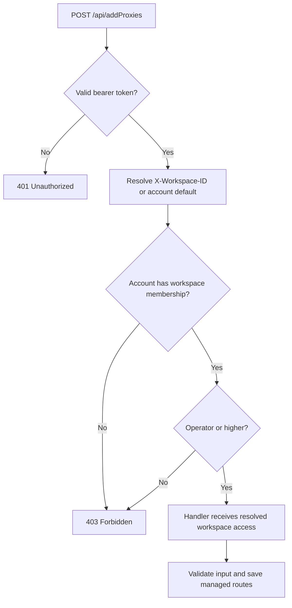
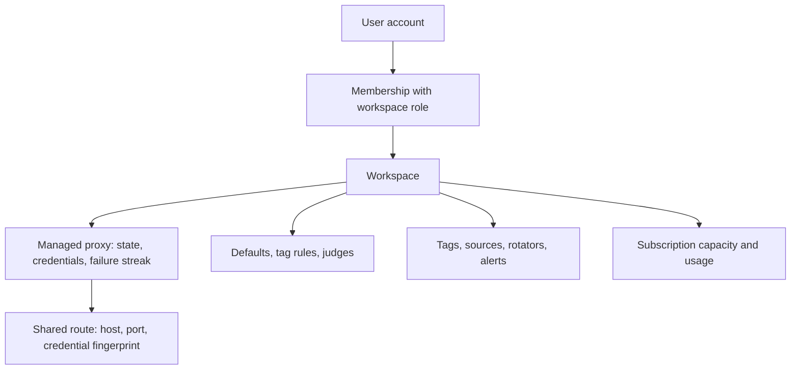

# API requests and workspace ownership

A request carries two different identities: the account making it and the
workspace whose resources it addresses. The bearer token authenticates the
account. Membership determines access to the workspace.

## Follow a proxy import request

For `POST /api/addProxies`, the route registration applies `RequireAuth` and
`withWorkspaceOperator` before calling the upload handler.

This shows the permission path. Request limits, CORS, logging, and endpoint
validation can reject requests separately. An invalid `X-Workspace-ID` value
returns `400`; a valid ID does not grant membership.

The API uses Go's `http.ServeMux`. REST routes sit under `/api`, and GraphQL
uses `/api/graphql`. GraphQL resolves the same authenticated workspace and
adds depth, field-count, query-size, and introspection guards.

## Ownership follows the workspace

The global route represents network identity. The managed proxy represents
one workspace's management of that identity. Its credentials are encrypted
in PostgreSQL. The legacy table name `user_proxies` remains, but its ownership
key is `workspace_id`, not the person who imported the route.

For example, Lab and Production can manage the same route. Lab pauses it after
three failing cycles; Production keeps it active with a different judge rule.
The shared route remains in the queue while at least one workspace actively
manages it. Each workspace has its own health evidence and failure streak.

## Roles exist at two levels

| Permission | Controlled by |
| --- | --- |
| Change global checker/scraper configuration or trigger global admin operations | Global account `admin` role. |
| Read workspace resources | Viewer or higher membership. |
| Import, tag, manage lifecycle, change checker settings, manage rotators | Operator or higher membership. |
| Manage permitted members and shared alert destinations | Workspace admin or owner. |
| Grant ownership or billing-administrator access | Workspace owner. |

A global administrator does not automatically get access to another workspace.
Removing a member changes access without deleting routes or reducing capacity.
An invitation grants no membership until its recipient accepts it.

## Settings also have different owners

- Environment variables configure the deployment, connections, secrets, and
  process limits.
- Global settings in `data/settings.json` configure instance behavior such as
  worker limits and cycle intervals.
- Workspace settings in PostgreSQL configure defaults, judges, tag rules,
  and automatic failure actions.
- Member preferences choose columns and similar display options within a
  workspace. A column-only save does not recompile checker settings.

Settings requests should send only the fields they edit. Resending a stale
complete settings object can overwrite a newer edit. The
[settings API](../api/rest-auth-and-user.md#post-apiusersettings) documents
patch semantics and the full checker-rule replacement behavior.

Checkpoint: an administrator receives 403 when reading a workspace. What should you inspect?

Check membership in the selected workspace and the required workspace role.
The token's global administrator role is a separate permission. Also inspect
whether the request selected the intended workspace.

Read the source: [route registration](https://github.com/Magpie-Tools/magpie-backend/blob/main/internal/app/server/routes.go),
[workspace middleware](https://github.com/Magpie-Tools/magpie-backend/blob/main/internal/app/server/workspace_middleware.go),
and the [resource glossary](https://github.com/Magpie-Tools/magpie-backend/blob/main/CONTEXT.md).

Next: [import and scraping](import-and-scraping.md).
