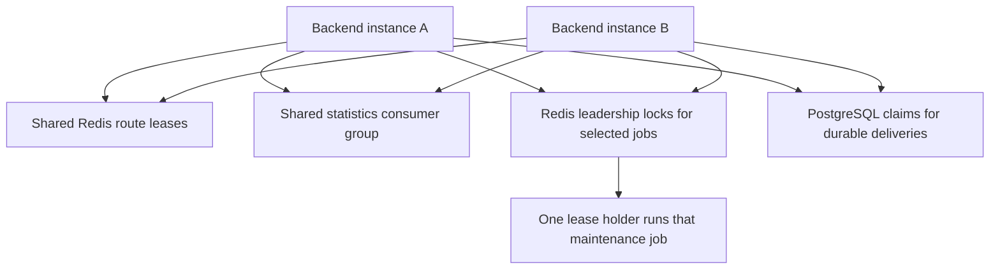

# Background jobs and replicas

The checker loop produces measurements. Separate jobs maintain derived data,
evaluate alerts, deliver messages, update enrichment, and clean old records.
Keeping these tasks separate avoids adding that work to each proxy check.

## Several instances share work in different ways

A **replica** is another backend process using the shared deployment's storage.
The coordination mechanism depends on the task:

| Work | Coordination |
| --- | --- |
| Proxy checks | Atomic Redis queue leases. Expired claims can be recovered. |
| Statistics ingestion | Redis Stream consumer group, pending recovery, and transactional replay protection. |
| Selected maintenance and queue reconstruction | Redis leadership locks. Leadership retries when Redis returns. |
| Email and alert delivery | Each instance claims durable PostgreSQL rows; workers can send in parallel. |
| Rotating listeners | Persisted instance assignment and local manager reconciliation. |
| Settings and judge caches | Notifications plus reconciliation of persisted revisions and state. |

Leadership is a renewable runtime lease, not a permanent primary node.
Interrupted passes and lost locks must be recoverable. Do not infer that every
background routine runs only once across the deployment.

## Alerts read existing measurements

Alert evaluation runs every minute under its own Redis leader lock. It batches
each workspace's enabled rules and reads existing current-health and historical
measurements. It does not issue extra proxy checks or add checker queue work.

Usable-route rules read workspace or rotator eligibility. Success-rate and
latency rules read attributed checker history in a 15-minute window. A rotator
rule's checker metrics cover its workspace's upstream protocol over TCP, not
only the routes currently surviving its pool filters and not client traffic.

Evaluation requires two minutes of observed breach to open an incident and
two healthy minutes to recover. Missing data, too few samples, or measurement
errors produce Unknown. They do not count as recovery. Rule state, incident
transitions, and delivery records commit together with revision/generation
checks so stale measurements cannot apply to edited configuration.

Delivery is another stage. Each instance runs ten alert delivery workers and
claims PostgreSQL rows with `SKIP LOCKED`. Claim tokens prevent stale workers
from recording outcomes for newer claims. Delivery retries up to four attempts.
A crash after the receiver accepts a message can still cause a duplicate, so
generic webhook receivers should deduplicate using `X-Magpie-Delivery-ID`.

The email outbox also has per-instance delivery workers. Its housekeeping is
leader-coordinated. Workspace invitations remain authoritative in PostgreSQL
even if an optional notification cannot be sent.

## Maintenance keeps long-running instances bounded

The job families include:

- History, response-body, snapshot, and timeline retention.
- Partition preparation, daily-counter compaction, and stream replay-ledger
  maintenance.
- Orphan-route cleanup after workspace management disappears.
- GeoLite and AbuseIPDB enrichment, judge refreshes, and blacklist refreshes.
- Expiry of password reset tokens, invitations, and terminal email rows.
- Dashboard, source-statistics, reputation, and workspace-usage refreshes.
- Bounded DNS/robots caches and recurring instance heartbeats.

Each has its own cadence and limits. The
[runtime jobs reference](../reference/runtime-jobs.md) records detailed timers
and query budgets; the [environment reference](../reference/environment-variables.md)
lists deployment overrides. Increasing worker count can move a bottleneck to
PostgreSQL, Redis, memory, or outbound bandwidth, so measure the whole pipeline.

## Watch whether work finishes

Readiness detects dependency and queue-bootstrap problems. Job progress needs
additional observation. Useful metric families include
`magpie_leader_job_active`,
`magpie_maintenance_last_success_timestamp_seconds`,
`magpie_maintenance_failures_total`, and
`magpie_statistics_replay_floor_timestamp_seconds`.

An active leader alone does not prove a job completed. Compare its last success,
failures, backlog, and logs. An old pending stream entry can hold back replay
ledger retirement even while new results continue to commit.

Checkpoint: should adding an alert condition add a database query to every proxy check?

No. The evaluator reads already persisted measurements on its own cadence.
Alert measurement and delivery work belongs outside the checker hot loop.
Any proposed per-check work needs a measured reason and review of its cost.

Read the source: [leadership helper](https://github.com/Magpie-Tools/magpie-backend/blob/main/internal/support/leadership.go),
[alert evaluation](https://github.com/Magpie-Tools/magpie-backend/blob/main/internal/jobs/runtime/alerts.go),
[email delivery](https://github.com/Magpie-Tools/magpie-backend/blob/main/internal/jobs/runtime/email_delivery.go),
and [runtime startup](https://github.com/Magpie-Tools/magpie-backend/blob/main/internal/app/bootstrap/setup.go).

Next: [code map and reading exercises](code-map.md).
