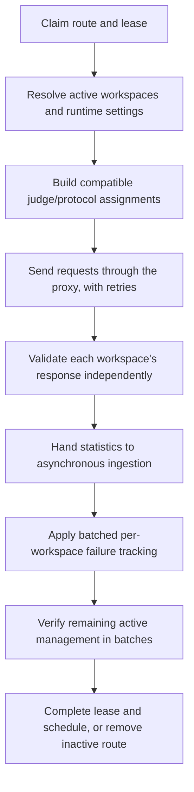
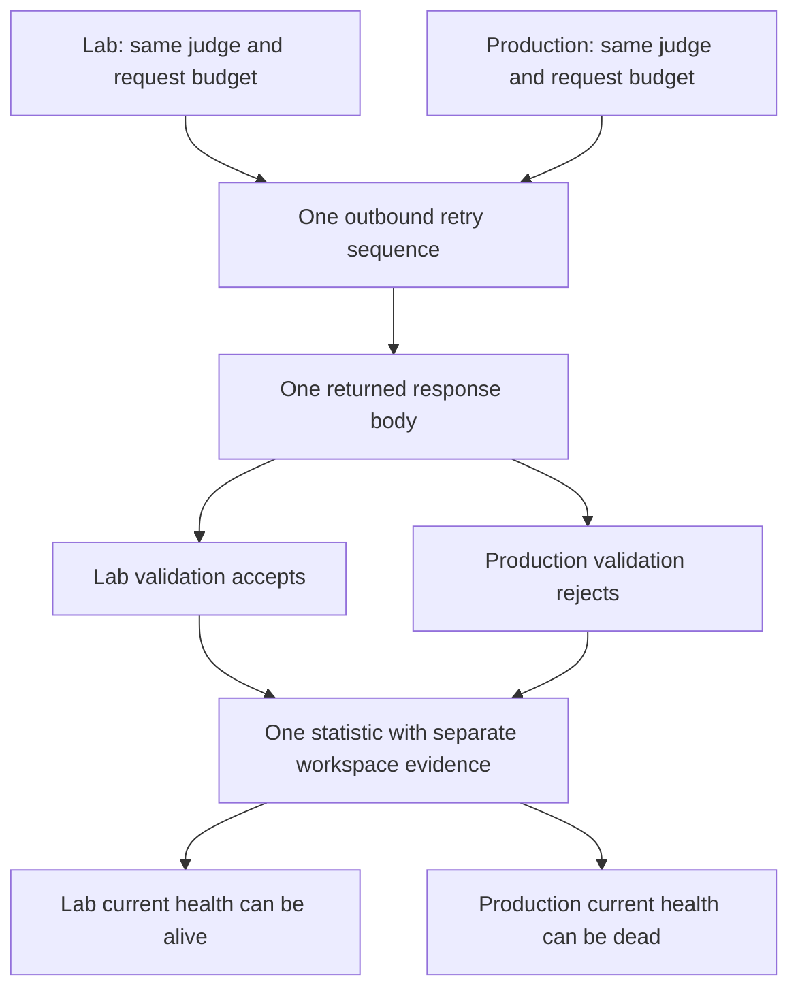

# The checker

One scheduled cycle begins when a worker claims a route. It ends by completing
or abandoning that lease. Inside the cycle, Magpie can run several protocol
checks and retries. A history row is not necessarily a whole cycle, and a
cycle is not necessarily one network request.

## Follow a cycle

Workers renew leases as needed between attempts. Lease loss, cancellation, or
an interrupted cycle can leave work for recovery rather than producing an
ordinary failed check.

## Resolve settings before the hot loop needs them

Workspace Default settings choose protocols and shared transport, timeout,
and retries. Matching tag rules apply from lowest priority to highest. Add
and Replace can override shared values; Remove changes protocol selection.
Judges, HTTPS-for-SOCKS, and automatic failure actions remain workspace-wide.

`checkerconfig` compiles immutable runtime snapshots at startup, on relevant
mutations, and during background reconciliation. A snapshot is a prepared,
read-only view that workers can share safely. It includes precomputed
configuration identities and effective plans for changed tagged routes.

The sparse `proxy_checker_plans` projection stores protocol keys that differ
from the workspace default. Workspace revisions and a coalesced route-change
journal let reconciliation skip unchanged assignments. Tags do not need to
travel in Redis payloads. The normal ready-snapshot path avoids loading tag
assignments or credentials from PostgreSQL for each check. A fallback exists
for settings snapshots that are not yet ready.

Suppose Default enables SOCKS5 at 7500 ms with two retries. A matching Add rule
adds HTTP and sets 5000 ms with one retry. Both protocols now use the 5000 ms
timeout and one retry. Higher priority rules apply last, so removing HTTP
later can cancel that addition.

## Share the request, keep verdicts separate

`buildRequestAssignments` can share one physical request when the judge,
proxy protocol, transport, timeout, and retry budget match. Workspace
validation still happens independently.

The physical statistic's aggregate `Alive` is true when any participating
workspace accepts the response. That value cannot substitute for another
workspace's health. `CheckEvidence` retains each workspace's verdict and
precompiled configuration key.

Current evidence is scoped to workspace, configuration, route, and protocol.
An old result remains history when settings change. It does not establish
health for a new timeout, transport, judge rule, or retry budget. While a
committed settings change awaits its projection refresh, current health is
unknown and rotation excludes affected workspace routes.

## Retry semantics are specific

`CheckProxyWithRetries` always makes the initial request, including when
retries is zero. It retries request errors and stops on a successful request.
Workspace response validation happens afterward and does not trigger retries.

With `retries=2`, a retry sequence can make up to three requests. If request
two succeeds but its body fails validation, the checker does not make request
three to search for a body that passes. One completed assignment creates one
statistic for the retry sequence, not one row per retry or per workspace.

`attempt` is zero-based. `attempt=1` means the second request succeeded or
finished the sequence. Response time describes the last request in
milliseconds, not the sum of all retries.

## Failure actions belong to managed proxies

After result handoff, the worker waits for batched failure tracking. For each
workspace participating in an eligible cycle:

| Outcome | Effect on that managed proxy |
| --- | --- |
| At least one successful check | Reset failure streak. |
| Eligible checks, none successful | Increment streak; apply configured Pause or Delete at its threshold. |
| No eligible checks | Leave streak unchanged. |

Disabled protocols or missing/blocked judges can leave no eligible checks.
An empty selection does not itself pause a proxy, and its active management
still consumes capacity.

Pause and Delete affect only that workspace. The worker updates ownership
when those actions commit, even if another part of the batch returns an error.
It then verifies active management using shared batched lookups. A negative
answer removes the queue entry. A lookup error leaves ownership unknown and
the worker attempts to requeue it. This lookup is an observation, not a
reservation against later edits.

Checkpoint: one shared response passes in Lab and fails in Production. Is the route globally alive?

There is no single current-health verdict that replaces workspace health.
Lab can have successful applicable evidence while Production has failing
evidence. Rotation and failure actions use the relevant workspace's verdicts.

Read the source: [worker and assignments](https://github.com/Magpie-Tools/magpie-backend/blob/main/internal/jobs/checker/thread_handler.go),
[runtime snapshots](https://github.com/Magpie-Tools/magpie-backend/blob/main/internal/checkerconfig/cache.go),
[failure tracking](https://github.com/Magpie-Tools/magpie-backend/blob/main/internal/jobs/checker/failure_tracker.go),
and [ownership verification](https://github.com/Magpie-Tools/magpie-backend/blob/main/internal/jobs/checker/ownership_verifier.go).

Next: [results, storage, and replay](results-and-storage.md).
