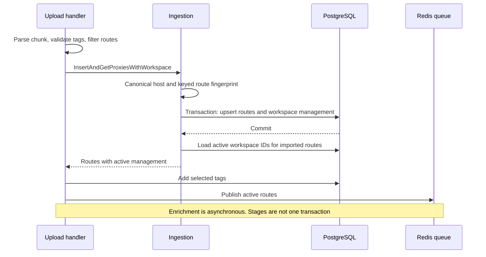
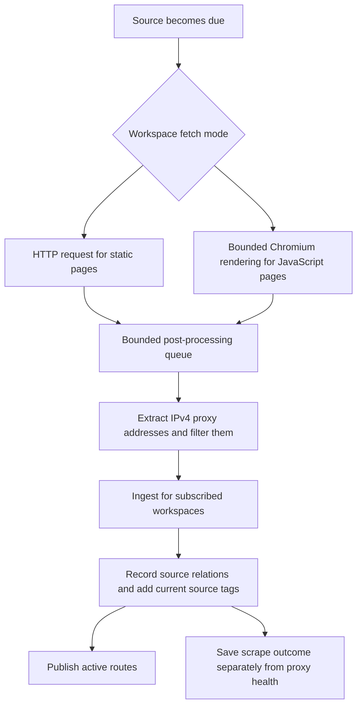

# Import and scraping

Manual upload and scraping enter through different parsers, then join the
same route-ingestion path. The durable output is a proxy route plus each
workspace's managed-proxy association. Queue publication follows storage.

## Manual import

The upload handler resolves the workspace, validates selected tags, parses
bounded chunks from multipart fields, and filters blacklisted routes. Each
flush calls `InsertAndGetProxiesWithWorkspace`.

Canonicalization lowercases DNS names, removes their trailing root dot, and
uses ASCII representation for internationalized names. The keyed fingerprint
includes host, port, and exact credentials, so changing credential case can
change route identity. A hostname's changing DNS answers do not create new
routes.

`Proxy` stores host, port, and fingerprint. Its in-memory username and password
are not columns on the global route row. `ManagedProxy` stores the workspace's
encrypted credential copy in `user_proxies`. Model hooks encrypt on save and
decrypt on load. Literal IP routes also have a PostgreSQL `inet` projection
for indexed address and subnet operations.

## Capacity and reimport behavior

Existing management keeps its lifecycle state when imported again. A paused
route stays paused. New management beyond a finite active capacity is stored
as paused rather than rejected or substituted for older active routes.

After the transaction, ingestion loads the complete active-workspace list for
each route. Suppose Lab already manages a route and Production now imports
it. Its published payload must retain both active workspace IDs so the
checker can share work and attribute results correctly.

Tag assignment is additive for import. It happens after the core resource
transaction. A tag-assignment error does not undo an already committed route.
Each upload chunk commits separately, so a failure in a later chunk does not
roll back previous chunks.

Redis publication errors are logged without failing an otherwise successful
upload. Therefore a `200` import response does not promise an immediate check.
Startup and queue-loss reconstruction can republish active inventory from
PostgreSQL. They cannot recover a lost pre-commit result.

## Scraping adds a fetch stage

HTTP is the default for new sources. Browser rendering starts on demand and
shares bounded browser capacity per instance, four pages by default. The
default post-processing queue holds 16 pending HTML results. These bounds keep
rendering and parsing from accumulating unlimited page memory.

Scraping currently extracts IPv4 routes only. Manual import supports provider
hostnames and IPv6 as well. Scraped routes enter the same capacity and lifecycle
rules as manually imported routes.

Source tagging reads the workspace's current saved rule when processing the
result. It adds missing assignments, including for existing or paused managed
proxies, without replacing manual tags. Source rules and tag assignments stay
outside the proxy queue payload.

New sources are eligible immediately. Every completed fetch, successful or
failed, schedules the next attempt after the configured instance scrape
interval. Repeated failures do not increase the interval. A valid `Retry-After`
header can delay the next attempt further and applies to both fetching modes
for that URL, including explicit administrator requeues.

Redis retains each mode's next attempt time and any provider deadline across
replicas. Browser capacity or startup problems defer pending work after 30
seconds or the interval, whichever is shorter, without recording an upstream
failure. Completed HTTP work keeps its normal due time while browser work waits.
A failed JavaScript scrape does not silently fall back to unrendered HTML.

An administrator requeue joins an active attempt instead of invalidating its
claim before a response deadline can be saved. Workers renew their five-minute
leases throughout fetching and blocked HTML handoffs. Failed renewal cancels the
work. Completion accepts mode progress only from the current claim, but merges
provider deadlines by maximum even from a stale claim. That preserves a newly
observed `Retry-After` without overwriting newer progress or recreating a removed
source.

Deploy all backend replicas together for this change. Older workers do not
read the new scheduling state and can still perform rapid upstream retries.
No database migration or new environment settings are required. Redis loss
discards scheduling progress; normal queue recovery makes subscribed sources
eligible again. Source details expose the next attempt and its reason.

Checkpoint: the final upload batch fails. Should the client assume the entire import was rolled back?

No. Earlier batches may already have committed. Refresh the workspace inventory
and inspect the report before retrying. Deduplication and lifecycle preservation
make reimport understandable, but the whole upload is not one transaction.

Read the source: [upload handler](https://github.com/Magpie-Tools/magpie-backend/blob/main/internal/app/server/route_proxy_handler.go),
[ingestion](https://github.com/Magpie-Tools/magpie-backend/blob/main/internal/database/database_proxy_ingestion.go),
[managed credential storage](https://github.com/Magpie-Tools/magpie-backend/blob/main/internal/database/proxy_access_credentials.go),
and [scraper workers](https://github.com/Magpie-Tools/magpie-backend/blob/main/internal/jobs/scraper/thread_handler.go).

Next: [queue scheduling and leases](queue-and-leases.md).
