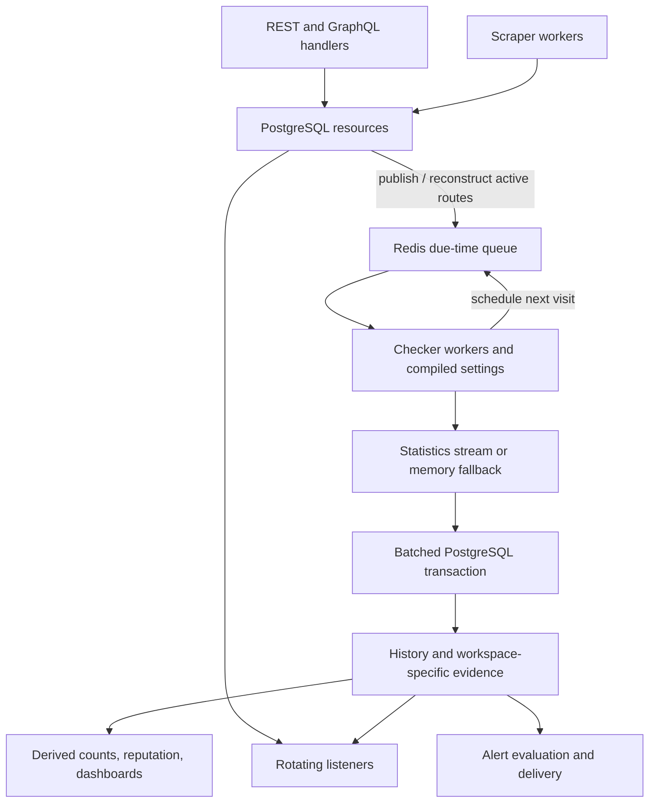

# Inside Magpie's backend

This section follows one route, `gateway.example.test:8080` with a fixed
credential pair, through Magpie. You will see who owns it, where it waits,
which requests a worker makes, when results become durable, and how a rotator
uses them. You can follow the explanations without knowing Go. Code links
and named functions let you inspect the implementation afterward.

If proxy routes, workspaces, or judges are unfamiliar, begin with
[How Magpie works](../learn/how-magpie-works.md).

## One process with several responsibilities

The default backend is one Go process. A **goroutine** is a concurrent task
inside that process. API handlers, worker pools, maintenance jobs, and rotating
listeners run together and share database and Redis clients.

Read the arrows as data dependencies. The statistics transaction happens
asynchronously after checking. A listener does not wait for an in-flight
check to finish before choosing from already committed evidence.

## Read in this order

Allow about an hour for the chapters and checkpoints. Use the code-reading
exercises as a second pass if you want to make backend changes.

| Chapter | Time | Question it answers |
| --- | --- | --- |
| [Startup and shutdown](startup-and-lifecycle.md) | 5 min | What starts, what is ready, and what survives a restart? |
| [API requests and workspace ownership](api-and-workspaces.md) | 5 min | How does a request get permission to touch a route? |
| [Import and scraping](import-and-scraping.md) | 7 min | How do input addresses become managed proxies? |
| [Queue scheduling and leases](queue-and-leases.md) | 8 min | How do workers share millions of recurring checks? |
| [The checker](checker.md) | 10 min | What is one cycle, and why can workspaces disagree? |
| [Results, storage, and replay](results-and-storage.md) | 10 min | When is a result durable, and what happens after failure? |
| [Rotating traffic](rotation.md) | 5 min | How does a listener choose an upstream? |
| [Background jobs and replicas](background-jobs.md) | 5 min | What runs around the loop without making each check heavier? |
| [Code map and reading exercises](code-map.md) | 5 min | Which files and tests should I read next? |

## Keep these storage boundaries in mind

| Place | What it holds | What recovery means |
| --- | --- | --- |
| PostgreSQL | Resource ownership, encrypted managed credentials, settings, committed check history, current evidence, outboxes | Restore the durable record from backups. |
| Redis proxy queue | Active route payloads, due times, temporary leases | Reconstruct active inventory from PostgreSQL. This cannot recreate lost measurements. |
| Redis statistics stream | Results waiting for PostgreSQL ingestion | Replay surviving entries, subject to Redis persistence and overload policy. |
| Process memory | Compiled settings, caches, HTTP clients, fallback results, unflushed usage | Rebuild derived state after restart. Buffered results and counters can be lost. |
| Backend data volume | Global settings and an automatically generated JWT signing key when configured that way | Preserve the volume and secrets across container replacement. |

PostgreSQL commit is the durable check-result boundary. A successful upload,
a completed network request, and Redis accepting a result are earlier stages
with different guarantees.

The [source walkthrough](https://github.com/Magpie-Tools/magpie-backend/blob/main/docs/architecture.md)
provides a compact companion for developers. The public chapters explain the
same contracts step by step.

Start with [startup and shutdown](startup-and-lifecycle.md).
