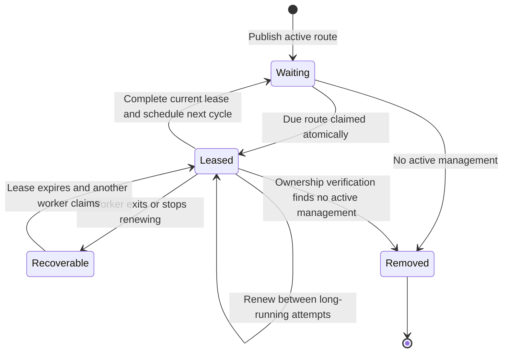
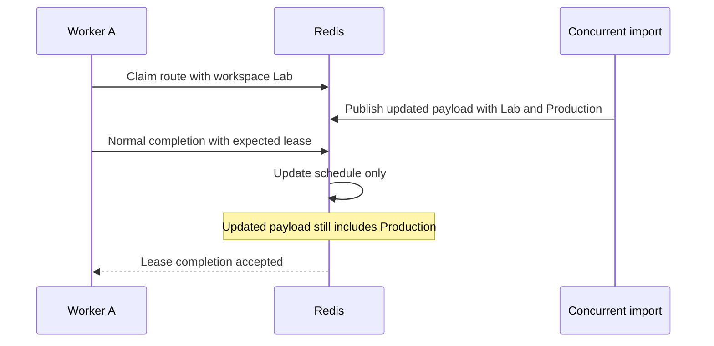

# Queue scheduling and leases

The proxy queue is a recurring schedule. Claiming a route does not permanently
remove it. Redis temporarily moves its due time into the future, giving a
worker a lease. Successful completion schedules the next cycle; a crashed
worker leaves work recoverable when its lease expires.

## Payload and schedule are separate

| Redis structure | Purpose |
| --- | --- |
| `proxy:<hash>` | Compact route payload with route ID, host, port, credentials, stored route hash, and active workspace IDs. |
| Sharded sorted sets | Route membership with numeric due-time scores in Unix milliseconds. |
| `proxy_queue_heads` | Index of the earliest score in each shard, so workers can find due work. |

A **sorted set** orders members by their score. Shards split the large queue
into several sets. The heads index tells the worker which shard to inspect
first. Batch imports spread initial due times across the checking interval.

The payload describes what to check. The sorted-set score describes when to
check it. Normal requeues change scheduling state without writing the payload.

## One lease lifecycle

`GetNextProxyContext` calls `pop.lua`, which atomically reads the payload and
moves the score to a five-minute lease expiry. The exact fractional `.5`
marks the score as a lease rather than an ordinary due time. The worker
retains its lease score, shard, original payload, and cancellation context.

The worker renews between outbound attempts when less than two minutes remain.
A short cycle needs no renewal command. If it loses the lease, it abandons
the cycle. Another worker can reclaim expired work.

## Completion must prove ownership of the lease

Imagine worker A claims a route and stalls. Its lease expires; worker B claims
it. If A finishes afterward, it must not overwrite B's schedule. `complete.lua`
compares the expected lease score with the current score and rejects stale
completion. Removal also checks the original payload so a stale worker cannot
erase a concurrent import.

Another race occurs when a workspace imports the route during a check. Normal
completion leaves the payload untouched. If the worker also needs an ownership
change, `RequeueProxyWithPayload` supplies its original snapshot and desired
payload. The completion script merges that worker's ownership delta into the
newer payload, retaining concurrently added workspaces and current credentials.

`RequeueProxy` schedules the next check from the later of the previous
scheduled time and now, plus the global checker interval. It avoids repeatedly
running overdue work to catch up. Tag profiles change the checks inside the
cycle, not this interval.

## The default queue path has a deliberate cost boundary

Magpie checks millions of routes repeatedly. It keeps work that belongs to
import or settings changes out of routine queue maintenance.

| Queue operation | Current default behavior |
| --- | --- |
| Decode a claimed payload | Decode its JSON and reuse the stored route hash. |
| Credential encryption/decryption or route-fingerprint calculation on dequeue | None for a current plaintext payload. |
| Load credentials from PostgreSQL on dequeue | None for a current payload. |
| Ordinary requeue | Complete the lease and update sorted-set scheduling through Lua. |
| JSON encode or payload `SET` on ordinary requeue | None. |
| Changed ownership, credentials, or payload format | Persist a changed payload through the appropriate mutation/migration path. |

This table describes queue payload maintenance. It does not claim that an
entire check has no database or Redis work. Failure tracking, batched ownership
verification, and result admission have separate responsibilities. A Lua call
also executes several Redis operations internally; one client call is not one
internal operation.

`PROXY_QUEUE_ENCRYPT_CREDENTIALS=false` is intentional. PostgreSQL encrypts
managed credentials; Redis is trusted runtime infrastructure. Protect Redis
with private networking, authentication, restricted ACLs, TLS for remote
connections, and encrypted volumes and backups.

Opt-in queue encryption encrypts new or changed payloads and decrypts on
dequeue. Normal requeue still avoids rewriting unchanged credentials. Readers
support legacy plaintext and encrypted payloads until an explicit migration
removes them. Keep `PROXY_ENCRYPTION_KEY` stable because PostgreSQL credentials,
keyed route fingerprints, and legacy encrypted queue data depend on it.

Checkpoint: why not encrypt and rewrite the route after every check?

Ordinary checks did not change its credentials or ownership. Repeating that
work adds cipher operations, JSON encoding, and payload writes to every cycle.
The current design pays for changed payloads when they change and uses the
stored hash while scheduling routine checks.

Read the source: [queue implementation](https://github.com/Magpie-Tools/magpie-backend/blob/main/internal/jobs/queue/proxy/proxy_queue.go),
[claim script](https://github.com/Magpie-Tools/magpie-backend/blob/main/internal/jobs/queue/proxy/pop.lua),
[completion script](https://github.com/Magpie-Tools/magpie-backend/blob/main/internal/jobs/queue/proxy/complete.lua),
and [Redis credential ADR](https://github.com/Magpie-Tools/magpie-backend/blob/main/docs/adr/0002-keep-hot-proxy-credentials-plaintext-in-redis.md).

Next: [the checker](checker.md).
