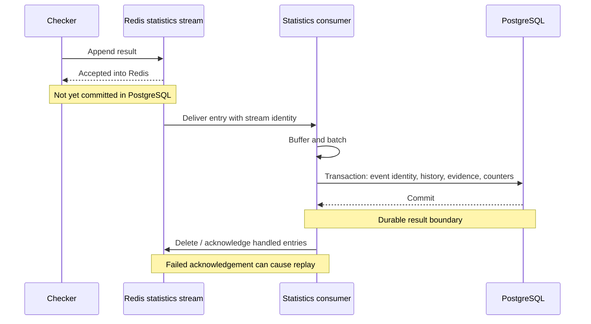
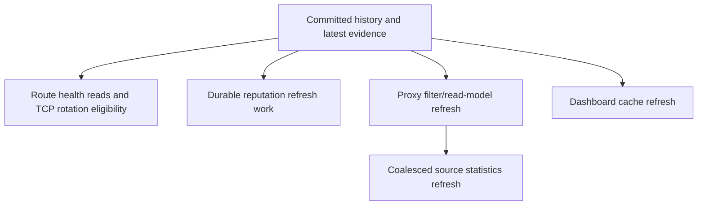

# Results, storage, and replay

The checker hands results to another set of workers. It does not write each
check directly to PostgreSQL. This separates network checking from batched
storage, but it also creates a period where a completed check is not yet
durable or visible to API readers.

## There are several success boundaries

`AddProxyStatisticForWorkspaces` returns no admission or commit status to its
caller. The checker can finish and schedule another cycle before this result
appears in PostgreSQL. Queue completion is separate from result persistence.

## Admission can wait, fall back, or drop

Redis Streams are enabled by default. Producers append to
`magpie:proxy_statistics:stream`; consumers share a group and buffer results.
The normal flush threshold is 5,000 results or a 15-second timer per worker.
Recovered partial pending batches also flush before waiting for new traffic.

When Redis is disabled, stream initialization is incomplete, or stream
admission fails, results can enter a memory fallback queue. Initialization
retries after an outage. Memory fallback is volatile and has no replay identity.

| Overload policy | Behavior to understand |
| --- | --- |
| `block`, the default | Wait/retry with a default 500 ms producer budget. Redis operation timeouts and retry sleeps mean this is not an exact wall-clock deadline. |
| `drop_new` | Reject a new result when admission is full. An intentional stream rejection bypasses memory fallback. |
| `evict_oldest` | Approximate stream trimming can discard unread or pending results. The memory path uses a timed wait instead of eviction. |

The memory queue defaults to 20,000 entries. Stream capacity checks and
appends are separate operations, so concurrent producers can exceed the
nominal cap. Rejected results are counted and logged; the checker receives
no error from this void handoff.

`PROXY_STATISTICS_TENANT_OVERLOAD_POLICIES` retains a legacy name and uses
workspace IDs. A shared result chooses the strongest policy among the default
and applicable overrides: `block`, then `drop_new`, then `evict_oldest`.
Overrides cannot weaken the default. A nonpositive producer-block timeout
allows unlimited stream retries under `block` while providing no memory wait.
See the [environment reference](../reference/environment-variables.md) before
changing admission settings.

## What commits together

`InsertProxyStatistics` commits accepted data in one PostgreSQL transaction:

- Replay-event identities, so the same stream event is not inserted twice.
- Physical check history with workspace evidence.
- Check counters and workspace usage attributed through the existing batch.
- Latest evidence keyed by workspace, configuration, route, and protocol.
- Durable requests to refresh affected reputation data.

A delayed older event cannot replace newer latest evidence. Obsolete settings
can contribute historical evidence without defining current health. Before
inserting, consumers exclude routes that have been deleted. Malformed stream
entries are logged and discarded with acknowledgement/deletion. A successful
flush therefore does not mean every originally submitted item became history.

## Replay handles an uncertain acknowledgement

| Failure point | Recovery |
| --- | --- |
| Database write fails before commit | Keep the batch and leave stream entries pending. Retry persistence. |
| Commit succeeds, then acknowledgement fails | Retry acknowledgement; another worker may reclaim idle pending entries. Event identities prevent duplicate history and counters. |
| Consumer crashes with a pending stream batch | Another consumer can reclaim surviving entries and retry. |
| Redis loses an entry before PostgreSQL commit | Queue reconstruction cannot recreate that result. Redis persistence and overload policy matter. |
| Process exits with memory-only results | Workers make a final bounded drain/insert attempt. A failed final attempt loses those results. |

Replay protection is part of the same transaction as history and counters.
Stream maintenance retires old event identities behind a durable replay floor
while preserving protection for unread and pending entries. Coordinated
PostgreSQL and Redis backups preserve those relationships.

## Read models refresh after the durable result

Reputation, source counts, filters, and dashboard caches can lag history.
They are derived views, rather than another copy of an individual check's
durability guarantee. Health reads also verify the current checker generation,
so a stale settings projection cannot make old evidence current.

Retention keeps storage bounded. Detailed history and response bodies have
separate retention settings. Monthly partitions are prepared ahead of time,
and older daily counters compact into lifetime totals. The
[storage reference](../reference/data-storage.md) describes table responsibilities;
[backup and recovery](../operations/backup-and-recovery.md) covers restoration.

Checkpoint: PostgreSQL committed a result and the worker crashed before acknowledging Redis. Will replay double the check count?

For the identified stream event, the transaction's replay ledger prevents a
second history insert and counter increment. The event can be handled again
and acknowledged. Memory fallback has no equivalent restart replay path.

Read the source: [statistics admission and consumers](https://github.com/Magpie-Tools/magpie-backend/blob/main/internal/jobs/runtime/proxy_statistics.go),
[transactional insertion](https://github.com/Magpie-Tools/magpie-backend/blob/main/internal/database/database_proxy_statistics_handl.go),
[latest evidence](https://github.com/Magpie-Tools/magpie-backend/blob/main/internal/database/database_proxy_status_handler.go),
and [stream maintenance](https://github.com/Magpie-Tools/magpie-backend/blob/main/internal/jobs/runtime/proxy_statistics_stream_maintenance.go).

Next: [rotating traffic](rotation.md).
