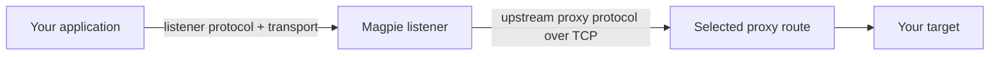
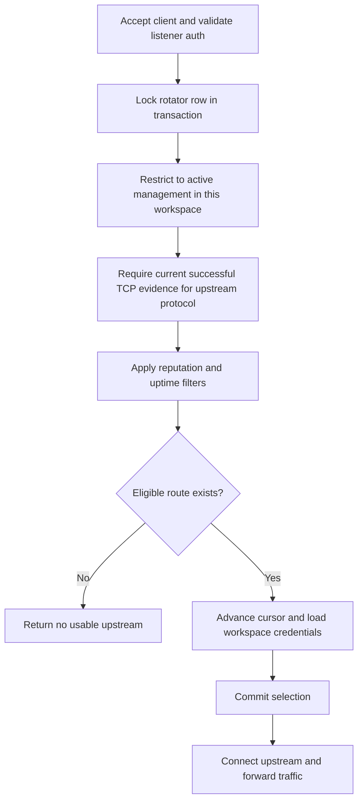

# Rotating traffic

A rotator is a workspace-owned listener configuration. The listener manager
starts configurations assigned to this backend instance and reconciles them
with persisted changes. Instance heartbeats advertise availability and free
listener ports so creation can choose a usable instance.

## The two sides of a rotator

Listener protocol describes how a client talks to Magpie. Upstream protocol
describes how Magpie talks to the chosen proxy. They can differ. Upstream
connections currently use TCP even when the listener accepts QUIC or HTTP/3.
SOCKS listeners require TCP.

Listener credentials protect access to Magpie. Stored upstream credentials
authenticate Magpie to the selected route. Neither credential pair is the
user account's dashboard password.

## Selection uses current committed evidence

For an accepted request or connection, the listener calls
`GetNextRotatingProxy`. Selection runs inside a PostgreSQL transaction that
locks the rotator row, finds the next qualifying route by ID after the saved
cursor, and wraps to the first candidate when needed.

Only this workspace's matching evidence qualifies a route. An older
configuration, another workspace's success, or a successful QUIC check cannot
qualify a TCP upstream. A pending checker-settings projection suppresses
current eligibility. Legacy generation-zero fixtures retain their compatibility
path, separate from normal attributed health.

Rotator creation requires its upstream protocol to be enabled in workspace
Default settings. A matching tag rule can still remove that protocol from
particular routes or change their checker transport, excluding those routes.
Uptime filters use the workspace's matching TCP evidence too.

## What selection does and does not guarantee

The row lock serializes cursor updates for this rotator. It does not reserve
the selected route exclusively for one client. Different rotators can choose
the same route, and a one-route pool can select the same upstream repeatedly.
Selection follows ID order rather than random choice.

A connection failure occurs after the selection transaction and does not undo
the cursor advance. The listener does not run a fresh judge check for every
client request. Evidence handed to statistics ingestion but not yet committed
cannot qualify the route.

An established CONNECT or SOCKS tunnel keeps its upstream while it forwards
bytes. A new upstream selection applies to subsequent requests or connections,
not to each packet in an existing tunnel. Stopping a listener closes its client
and upstream sockets.

`POST /api/rotatingProxies/{id}/next` also selects and advances the cursor. It
is useful for integration, but repeatedly calling it is not a read-only pool
preview. Its response contains upstream credentials, so treat it accordingly.

## Traffic usage stays off the request's database write path

Listeners increment in-memory monthly request and payload-byte counters.
A background routine flushes aggregate deltas to workspace usage. HTTP requests
and established CONNECT/SOCKS tunnels count as managed requests; payload bytes
exclude protocol headers. A successful check and a successful client request
are different measurements.

Checkpoint: why can a route pass an HTTP/3 check but remain unusable by a rotator?

The current upstream connection uses TCP. It needs successful current TCP
evidence for the selected upstream proxy protocol and workspace. HTTP/3
checker evidence does not meet that requirement.

Read the source: [listener manager](https://github.com/Magpie-Tools/magpie-backend/blob/main/internal/rotatingproxy/manager.go),
[selection transaction](https://github.com/Magpie-Tools/magpie-backend/blob/main/internal/database/database_rotating_proxy_handler.go),
and [forwarding handlers](https://github.com/Magpie-Tools/magpie-backend/blob/main/internal/rotatingproxy/handler.go).
The [rotator API](../api/rest-rotating-proxies.md) documents payloads and errors.

Next: [background jobs and replicas](background-jobs.md).
