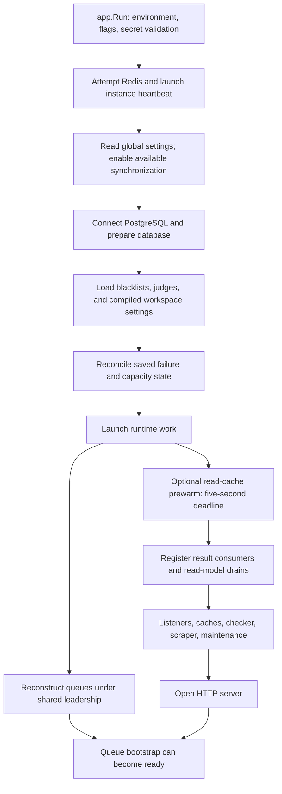
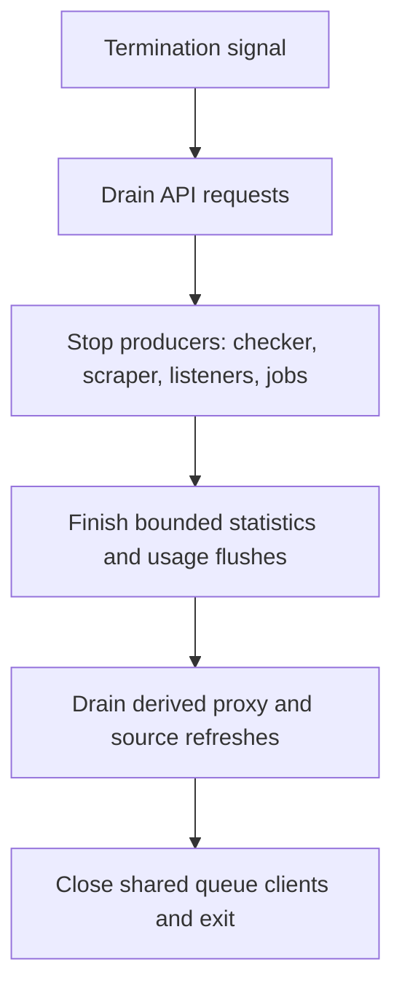

# Startup and shutdown

`cmd/magpie/main.go` calls `app.Run`. The application loads `.env`, parses flags,
chooses production policy, validates secrets and optional email configuration,
then prepares runtime services. The API opens after bootstrap setup returns.
Some setup work continues in the background.

## Migration is a separate mode

`--migrate-only` validates the proxy encryption key, runs database migrations,
and exits. It does not start the HTTP server, checker, scraper, or listeners.
The distribution's installer and update scripts use this mode. The standard
Compose stack sets `DB_AUTO_MIGRATE=false`, so a new image does not silently
perform schema changes during normal startup.

For deployment commands and upgrade sequencing, use
[updating](../getting-started/updating.md). Keep all backend versions compatible
with the migrated schema.

## Normal bootstrap

The diagram groups related steps. Read
[`bootstrap.Setup`](https://github.com/Magpie-Tools/magpie-backend/blob/main/internal/app/bootstrap/setup.go)
for the exact order. Settings load before queue interval synchronization starts,
so a placeholder interval cannot overwrite the configured interval in Redis.

Queue reconstruction reads active inventory in batches. It uses shared Redis
leadership so replicas do not rebuild the same queues independently. The
default `STARTUP_QUEUE_BOOTSTRAP_ASYNC=true` allows the API to open while this
work runs. Queue bootstrap failures retry after ten seconds.

Normal startup waits for optional dashboard cache prewarming with one
five-second total deadline. It uses the requested-component refresh path; a
new process has no dashboard demand and no work to prewarm. An incomplete
optional refresh does not prevent startup. The timer still runs every
30 seconds, but refreshes only components read within the preceding two
minutes. Info, recent checks and fastest routes have separate demand keys,
including each normalized list limit. Internal refreshes do not renew demand.
Cache prewarming is not a readiness requirement or a substitute for validating
dashboard latency.

A successful cache hit is at most 30 seconds old. Cold and expired reads load
synchronously or join the refresh already running for that component. REST
and GraphQL pass their request contexts to the loaders. Each refresh also has
a 30-second child deadline, and its database work must finish or cancel before
the shared refresh completes. A failed refresh preserves the previous stored
entry without making an expired entry a valid hit. Existing checker-generation
and dirty-health guards still apply. Idle demand and cache entries expire;
process restarts clear demand.

Prewarming finishes or cancels before runtime listeners open. Result consumers
and read-model drains are registered before listeners, checker and scraper
workers can produce traffic. A termination signal during startup cancels the
prewarm and prevents the remaining startup work and API from beginning. Already
registered runtime groups still stop in their normal drain order.

The instance can start with Redis unavailable and retry synchronization later.
That is a degraded process, not proof that checking and distributed work are
operational.

## Liveness and readiness answer different questions

| Probe | Question | Important limit |
| --- | --- | --- |
| `/healthz` | Is this HTTP process alive? | Does not prove the database, Redis, queues, or judges work. |
| `/readyz` | Are PostgreSQL, Redis policy, and startup queue bootstrap ready? | A successful probe does not test every upstream proxy or judge. |
| `/metrics` | What are the runtime counters and timings? | Access follows observability protection, separate from normal API auth. |

By default, Redis failure or incomplete queue bootstrap makes readiness return
`503`. `READYZ_ALLOW_REDIS_DEGRADED=true` permits a degraded `200` when its
database and bootstrap policy allow it. Use that policy deliberately because
it changes what a load balancer considers ready.

Every ten seconds the queue monitor checks queue markers. Missing queues
trigger reconstruction from PostgreSQL under shared leadership. Readiness
becomes unavailable after the loss is detected. Queue reconstruction restores
scheduled resources; it cannot reconstruct check results that never committed.

## Shutdown preserves the producer/consumer order

On SIGTERM or Ctrl+C, the HTTP server drains before runtime shutdown. Runtime
groups have their own cancellation contexts so they can finish in order.

Stopping consumers before producers would allow final results to arrive after
their consumers had gone. Stopping read models too early would miss
invalidations from final commits. These dependencies explain the shutdown
order in `Runtime.Shutdown`.

Dashboard jobs pass cancellation through their database reads and delayed
counter backfills. Stopping the producer group cancels an in-flight refresh
instead of waiting for every workspace query to finish. Failed refreshes leave
the previous cache snapshot available.

Memory statistics consumers retry unfinished suffixes until their buffers are
empty. Each flush shares one 30-second preparation/write deadline across its
transactions. A failed attempt keeps the consumer active, so the overall
background shutdown deadline reports incomplete draining. Pending Redis stream
entries retain their separate replay path.

Final read-model draining retries failed or timed-out proxy and source batches
with a 250 ms backoff until both dirty queues are empty. Proxy batches use
`READ_MODEL_REFRESH_TIMEOUT_SECONDS`; source-counter batches retain a 30-second
deadline. The worker stays active while retrying, so unresolved work makes the
overall background shutdown deadline fail with an error instead of reporting a
successful drain.

Dirty notifications are held in memory. A failed shutdown can therefore leave
nonempty derived filters stale after restart. With all backend writers stopped,
`--rebuild-read-models` rebuilds proxy filters and source counters from durable
PostgreSQL state in bounded pages. It requires the existing encryption key and
schema, skips migration and default seeding, and starts no API or jobs. See
[the repair procedure](../operations/backup-and-recovery.md#repair-derived-state-after-an-interrupted-shutdown)
before resuming service or repeating a coordinated backup.

Defaults allow 20 seconds for HTTP drain, 60 seconds for background shutdown,
and 90 seconds of Compose stop grace. If you increase application timeouts,
increase `BACKEND_STOP_GRACE_PERIOD` to cover them. A hard kill can still lose
volatile buffers. [Results and replay](results-and-storage.md) distinguishes
pending stream entries from memory-only results.

`DEVELOPMENT_FIXTURES=true` takes a separate path. It loads fixture settings and
read caches but skips autonomous jobs and rotating listeners. Its cache prewarm
explicitly visits all workspaces, has the same five-second total deadline, and
a prewarm failure still aborts fixture startup. It does not create ongoing
dashboard demand. Fixture mode is rejected in production.

Checkpoint: why can healthz return 200 while readyz returns 503?

The process can answer HTTP while a dependency is unavailable or active queues
are still being reconstructed. A liveness restart is not automatically the
right response to a readiness failure.

Read the source: [application lifecycle](https://github.com/Magpie-Tools/magpie-backend/blob/main/internal/app/app.go),
[ordered shutdown](https://github.com/Magpie-Tools/magpie-backend/blob/main/internal/app/bootstrap/lifecycle.go),
and [probe handlers](https://github.com/Magpie-Tools/magpie-backend/blob/main/internal/app/server/route_health_handler.go).

Next: [API requests and workspace ownership](api-and-workspaces.md).
