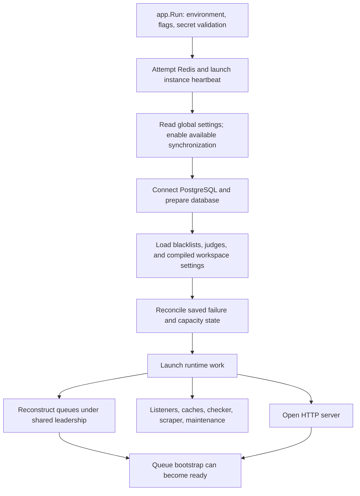
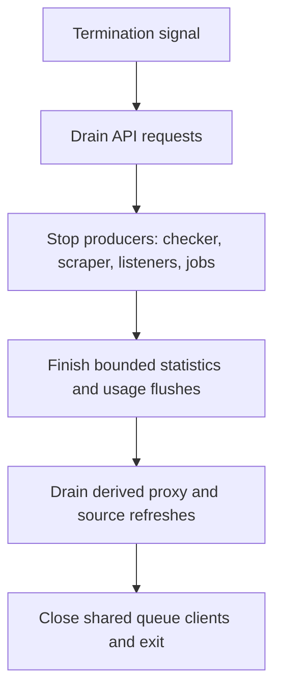

# Startup and shutdown

`cmd/magpie/main.go` calls `app.Run`. The application loads `.env`, parses flags,
chooses production policy, validates secrets and optional email configuration,
then prepares runtime services. The API opens after bootstrap setup returns.
Some setup work continues in the background.

## Migration is a separate mode

`--migrate-only` validates the proxy encryption key, runs database migrations,
and exits. It does not start the HTTP server, checker, scraper, or listeners.
The distribution's installer and update scripts use this mode. The standard
Compose stack sets `DB_AUTO_MIGRATE=false`, so a new image does not silently
perform schema changes during normal startup.

For deployment commands and upgrade sequencing, use
[updating](../getting-started/updating.md). Keep all backend versions compatible
with the migrated schema.

## Normal bootstrap

The diagram groups related steps. Read
[`bootstrap.Setup`](https://github.com/Magpie-Tools/magpie-backend/blob/main/internal/app/bootstrap/setup.go)
for the exact order. Settings load before queue interval synchronization starts,
so a placeholder interval cannot overwrite the configured interval in Redis.

Queue reconstruction reads active inventory in batches. It uses shared Redis
leadership so replicas do not rebuild the same queues independently. The
default `STARTUP_QUEUE_BOOTSTRAP_ASYNC=true` allows the API to open while this
work runs. Queue bootstrap failures retry after ten seconds.

The instance can start with Redis unavailable and retry synchronization later.
That is a degraded process, not proof that checking and distributed work are
operational.

## Liveness and readiness answer different questions

| Probe | Question | Important limit |
| --- | --- | --- |
| `/healthz` | Is this HTTP process alive? | Does not prove the database, Redis, queues, or judges work. |
| `/readyz` | Are PostgreSQL, Redis policy, and startup queue bootstrap ready? | A successful probe does not test every upstream proxy or judge. |
| `/metrics` | What are the runtime counters and timings? | Access follows observability protection, separate from normal API auth. |

By default, Redis failure or incomplete queue bootstrap makes readiness return
`503`. `READYZ_ALLOW_REDIS_DEGRADED=true` permits a degraded `200` when its
database and bootstrap policy allow it. Use that policy deliberately because
it changes what a load balancer considers ready.

Every ten seconds the queue monitor checks queue markers. Missing queues
trigger reconstruction from PostgreSQL under shared leadership. Readiness
becomes unavailable after the loss is detected. Queue reconstruction restores
scheduled resources; it cannot reconstruct check results that never committed.

## Shutdown preserves the producer/consumer order

On SIGTERM or Ctrl+C, the HTTP server drains before runtime shutdown. Runtime
groups have their own cancellation contexts so they can finish in order.

Stopping consumers before producers would allow final results to arrive after
their consumers had gone. Stopping read models too early would miss
invalidations from final commits. These dependencies explain the shutdown
order in `Runtime.Shutdown`.

Defaults allow 20 seconds for HTTP drain, 60 seconds for background shutdown,
and 90 seconds of Compose stop grace. If you increase application timeouts,
increase `BACKEND_STOP_GRACE_PERIOD` to cover them. A hard kill can still lose
volatile buffers. [Results and replay](results-and-storage.md) distinguishes
pending stream entries from memory-only results.

`DEVELOPMENT_FIXTURES=true` takes a separate path. It loads fixture settings and
read caches but skips autonomous jobs and rotating listeners. Fixture mode is
rejected in production.

Checkpoint: why can healthz return 200 while readyz returns 503?

The process can answer HTTP while a dependency is unavailable or active queues
are still being reconstructed. A liveness restart is not automatically the
right response to a readiness failure.

Read the source: [application lifecycle](https://github.com/Magpie-Tools/magpie-backend/blob/main/internal/app/app.go),
[ordered shutdown](https://github.com/Magpie-Tools/magpie-backend/blob/main/internal/app/bootstrap/lifecycle.go),
and [probe handlers](https://github.com/Magpie-Tools/magpie-backend/blob/main/internal/app/server/route_health_handler.go).

Next: [API requests and workspace ownership](api-and-workspaces.md).
