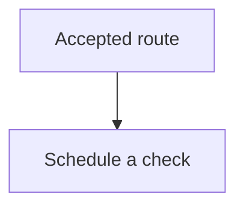

# Documentation maintenance

Docs live in the `magpie-docs` repository. When documentation accompanies a
change in another repository, cross-link the pull requests.

## Local docs development

```bash
npm ci
npm run start
```

## Build verification

```bash
npm run typecheck
npm run build
```

The build rejects broken internal links and anchors. Preview the built site
with `npm run serve` as well: Mermaid renders in the browser, so a successful
static build alone does not prove every diagram renders correctly.

## Keep the learning path useful

- `docs/learn` introduces terms before using them, follows visible workflows,
  and ends lessons with a question and an expandable answer.
- `docs/backend` explains mechanisms, failure boundaries, and source entry
  points. Update it when those contracts change.
- `docs/user-guide` documents controls and feature behavior.
- `docs/reference`, `docs/api`, and `docs/operations` provide lookup detail
  and runbooks. Link them from lessons instead of inserting every field into
  the beginner path.

Keep domain terms aligned with the backend's `CONTEXT.md`. In particular,
distinguish a route from a managed proxy, account roles from workspace roles,
and lifecycle from health. Mark reserved address examples as syntax examples,
and do not promise live traffic from development fixtures.

## Diagrams

Use a Mermaid diagram when it makes relationships, sequencing, or state
transitions easier to understand. Keep labels short, use a small number of
participants, and explain the important conclusion in the surrounding prose.
An illustration should answer a question that a list of package names cannot.

````text

````

The Mermaid theme is pinned to the same version as Docusaurus and configured
in `docusaurus.config.ts`, following the
[Docusaurus diagram integration](https://docusaurus.io/docs/3.9.2/markdown-features/diagrams).
`src/theme/Mermaid` wraps diagrams with horizontal scrolling and a native
dialog for a larger view. It supports keyboard focus, Escape, and light/dark
themes. Keep accessible titles and descriptions in each diagram's source.

Before delivering a docs change, inspect the affected pages in a browser:

1. Check the diagram labels and prose at a desktop width.
2. Expand a diagram, close with Escape, and confirm focus returns to its button.
3. Check dark mode and a narrow viewport. Wide content should scroll within
   the diagram instead of widening the page.
4. Open checkpoint answers and follow the lesson's next-step link.

Do not add screenshots that imply a live feature works when the image shows
fixtures. For screenshots of real UI, remove account and proxy credentials
and retain a text explanation so the page is useful without the image.

## Content guidelines

- Prefer behavior that is observable in code
- Call out constraints and defaults explicitly
- Keep API examples aligned with actual payload shapes
- Cross-link documentation and implementation pull requests
