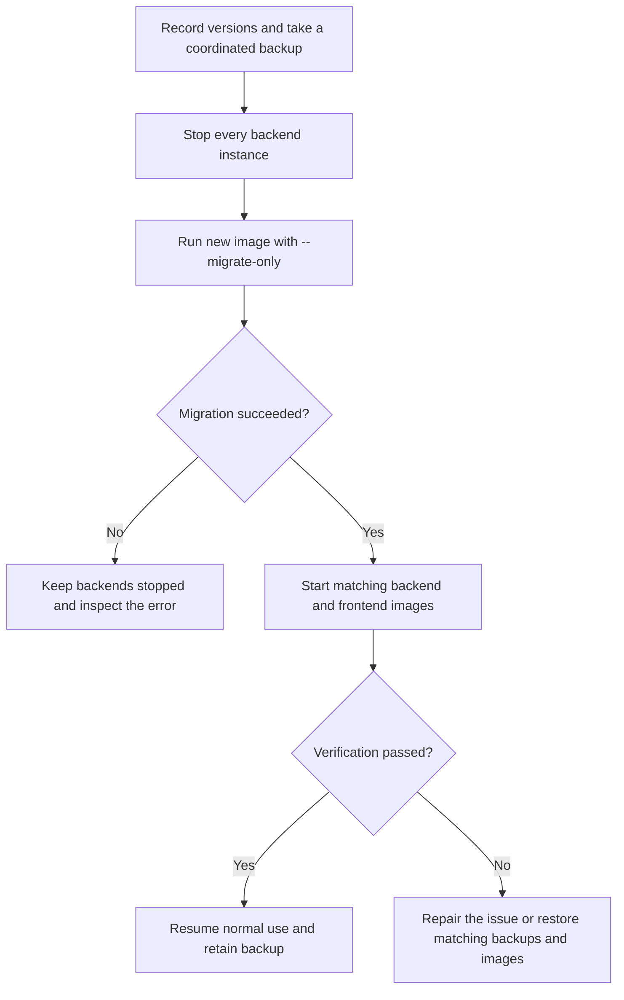

# Updating

An update replaces the application images and may change the database schema.
Plan a short maintenance window. Keep a coordinated backup of PostgreSQL,
Redis, configuration, and keys until the new version is verified.

If you are installing Magpie for the first time, use
[Installation](./installation.md) instead.

## Before you update

1. Read the release notes for the versions you are crossing. Check the migration
   notes below when upgrading an older installation.
2. Record the current backend and frontend image tags or digests. A floating
   `latest` tag alone does not identify a recoverable version.
3. Take and verify a [coordinated backup](../operations/backup-and-recovery.md).
4. Confirm the Compose project name, ordered file list, and installation
   directory. They select your existing volumes and networks.
5. Keep `PROXY_ENCRYPTION_KEY` and the JWT signing secret unchanged. Stop every
   backend instance before migration, including replicas on other hosts.



## Run the update helper

For an installation created by the one-command installer, run the appropriate
command from the installation directory.

### macOS and Linux

```bash
curl -fsSL https://raw.githubusercontent.com/Magpie-Tools/magpie/refs/heads/master/scripts/update.sh | bash
```

### Windows PowerShell

```powershell
iwr -useb https://raw.githubusercontent.com/Magpie-Tools/magpie/refs/heads/master/scripts/update.ps1 | iex
```

For a Git checkout of the distribution repository, use its wrapper:

```bash
./scripts/update-stack.sh
```

On Windows CMD:

```bat
scripts\update-stack.bat
```

The bundled helpers stop the backend, run the new image's migration, and restart
only after it succeeds. Read the output before leaving the maintenance window.
Do not start an old backend to work around a migration failure.

## Keep the same Compose configuration

The Bash and PowerShell helpers inspect Docker labels to recover this
installation's project name, working directory, and ordered Compose file list.
This includes names set by an overlay's `name:`, `-p`, or
`COMPOSE_PROJECT_NAME`. The recovered name stays fixed even if downloaded
configuration changes it.

A stopped backend retains these labels, so a retry after a failed migration can
reuse the same project and production overlay. Helpers ignore unrelated
projects and one-off migration containers. Missing files, an inspection error,
or multiple matching configurations stop the update before the backend stops.
The Git checkout wrappers use the same logic.

After `docker compose down`, there is no backend container to inspect. Save your
selection in `.env` before removing containers:

```dotenv
COMPOSE_FILE=docker-compose.yml:docker-compose.production.yml
# Set this too if the installation uses a custom project name:
# COMPOSE_PROJECT_NAME=magpie-production
```

Use `;` instead of `:` on Windows. Append custom overlays in their original
order. Without an existing backend, helpers use Compose settings from the shell
or `.env`, or the normal default files. `MAGPIE_ENV=production` also enables
backend production defaults, but the file selection still determines mounts,
ports, and other Compose behavior.

## Manual production update

Run this Bash block from the distribution directory. Add every custom overlay
to every command, or persist the full list through `COMPOSE_FILE`.
The subshell exits on a failed command, leaving the backend stopped after a
migration failure.

```bash
(
  set -e
  docker compose -f docker-compose.yml -f docker-compose.production.yml pull
  docker compose -f docker-compose.yml -f docker-compose.production.yml stop backend
  docker compose -f docker-compose.yml -f docker-compose.production.yml run --rm backend --migrate-only
  docker compose -f docker-compose.yml -f docker-compose.production.yml up -d
)
```

This stops the backend in this Compose project. Stop any other instances that
share its database and Redis before running it. Keep all instances stopped
until the migration finishes.

## Verify the new version

1. Run `docker compose ps` and inspect `docker compose logs --tail=100 backend`
   with the same file selection.
2. Check readiness through your monitoring path. In production, send
   `X-Observability-Token` when required.
3. Sign in, select the expected workspace, and compare active, paused, and
   archived proxy counts with your pre-update notes.
4. Confirm new checks complete and scraper jobs resume. After checker settings
   migrations, current health can stay unknown until matching evidence arrives.
5. Test one rotating listener with the protocol and credentials your clients use.
   Review [alerts](../user-guide/alerts.md) and outbound email if configured.

Use [Troubleshooting](../operations/troubleshooting.md) for a specific failure.
A running container alone does not prove the update succeeded.

## Roll back after a schema change

Restore the matching PostgreSQL and Redis backups, configuration, keys, and
previous component images using the [recovery runbook](../operations/backup-and-recovery.md).
Schema migrations can remove columns that older binaries need. Changing an
image tag back is therefore insufficient after an incompatible migration.

## Migration notes for older installations

### Workspace ownership migration

The workspace release performs an ownership-boundary migration:

- creates one personal workspace, owner membership, entitlement, and preference
  row for every existing account;
- copies each account's operational settings into that workspace;
- moves managed proxies, tags, assignments, judges, scrape sources, rotators,
  histories, and snapshots from `user_id` ownership to `workspace_id` ownership;
- keeps existing managed proxies active initially; and
- repairs PostgreSQL foreign keys to reference `workspaces`.

The migration deliberately uses the legacy account ID as the personal
workspace ID where possible, but clients must discover workspaces through
`GET /api/workspaces` instead of relying on that detail. Existing API clients
that omit `X-Workspace-ID` continue through the migrated default workspace.

Do not run an older backend against the migrated database. There is no in-place
downgrade because ownership columns and constraints have changed; restore the
coordinated PostgreSQL and Redis backups to roll back.

### Tag checker settings migration

Update the frontend and every backend instance together. Stop all backend
instances, run `--migrate-only`, and start the new images after it succeeds.
This release adds workspace protocol defaults and ordered tag rules, a sparse
projection for tagged proxy checks, and workspace/configuration attribution to
latest statistics. The latest-statistics primary key changes; older workers
must not write to the migrated database.

Existing checker values become shared Default settings with no tag rules.
Earlier per-protocol draft profiles remain readable and convert to shared values
using the first enabled Default protocol and first explicit rule fields in
HTTP, HTTPS, SOCKS4, SOCKS5 order. If converted transports are incompatible with
SOCKS, conversion uses TCP. Legacy statistics remain available as history. Their
transport and settings cannot be reliably attributed, so current health starts
unknown until fresh matching checks complete. TCP rotators also wait for current
TCP evidence. Existing failure streaks are retained.

No new environment variables are needed. Keep `PROXY_ENCRYPTION_KEY` stable and
retain the coordinated backups for rollback. Redis queue payloads and ordinary
requeue scheduling keep their existing format and credential policy.

Checker projection refreshes reconcile committed keys and tag overrides across
backend instances. Unrelated classification tags do not refresh workspace health,
and checker tag edits refresh only affected proxy and source summaries. Dashboard
caches verify the committed checker generation before serving health. Unchanged
reconciliation skips route reads; column-only saves skip checker refresh. Recent
checks select indexed candidates before fetching their evidence.

Run the updated migration even when upgrading an earlier tag-settings build. It
adds workspace revision counters, a coalesced per-route change journal, and an
index for active recent-check candidates. These changes require no new environment
settings and add no database queries to individual checker runs.
The journal retains temporary removal records so a reimported proxy does not
reuse settings from its previous tag membership. Retention maintenance expires
committed removal records after 24 hours; workspace deletion removes its journal.
