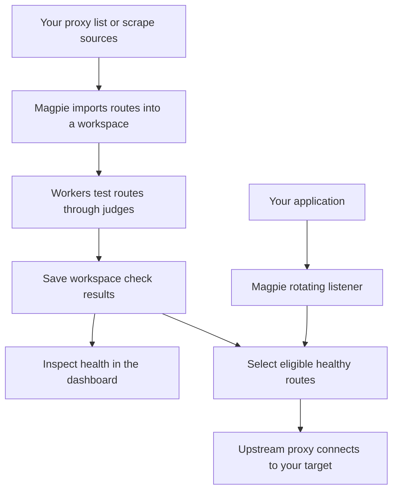

import Link from '@docusaurus/Link';

# Understand your proxy pool

Magpie is a self-hosted proxy manager. You give it proxy addresses or webpages
that list them. It checks those proxies repeatedly, records the results, and
lets your applications connect through a rotating selection of healthy routes.
The web dashboard and API manage the same workspace resources.

  <Link className="docs-path" to="/learn/">
    Start here
    <h2>Learn Magpie</h2>
    
A guided afternoon for a first-time user. Learn the terms, import a route, read a check, and connect through a rotator.

    Follow the learning path →
  </Link>
  <Link className="docs-path" to="/backend/">
    Go deeper
    <h2>Inside the backend</h2>
    
Follow a route through the Go process, Redis scheduling, workspace checks, PostgreSQL results, and upstream selection.

    Explore the backend →
  </Link>
  <Link className="docs-path" to="/getting-started/quick-start">
    Get running
    <h2>Install Magpie</h2>
    
Start the Docker Compose stack, create your first account, and verify that the backend is ready.

    Open the quick start →
  </Link>

## The whole workflow

Magpie manages proxies you supply or discover. A successful import only means
Magpie accepted the route. A successful check means it passed a particular
workspace's validation at that time. Neither guarantees that every target
website will accept traffic through it.

## Find the right guide

| You want to… | Read |
| --- | --- |
| Understand proxies and the parts of Magpie | [How Magpie works](learn/how-magpie-works.md) |
| Learn by doing | [Your first proxy workflow](learn/first-proxy.md) |
| Add sources, tags, and alerts | [Build a pool that maintains itself](learn/automate-a-pool.md) |
| Explain an empty pool or an unknown health result | [Observe and troubleshoot](learn/observe-and-troubleshoot.md) |
| Understand the implementation | [Backend internals](backend/index.md) |
| Look up a field or endpoint | [Configuration](reference/configuration.md), [environment variables](reference/environment-variables.md), or [REST API](api/rest-overview.md) |
| Run a server for other people | [Deployment](operations/deployment.md), [security](operations/security.md), and [backups](operations/backup-and-recovery.md) |

The code lives in the [Magpie-Tools repositories](https://github.com/Magpie-Tools).
The [backend code map](backend/code-map.md) explains which repository and package
owns each part.
