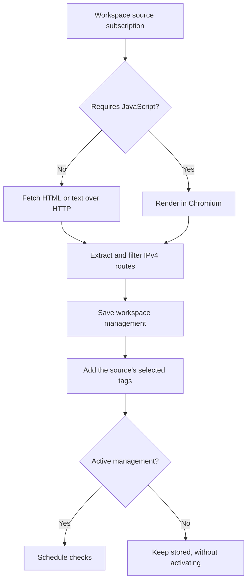

# Build a pool that maintains itself

Once one route works, automate discovery and decide what Magpie should do as
routes change. This lesson uses a small research pool. Apply it in a workspace
where you can experiment with sources and settings.

## 1. Add a source and label its results

Open `/scraper` and add a webpage that lists proxies and permits your use.
Choose an existing workspace tag such as `Research` under **Automatic tags**.
Leave **Requires JavaScript** off for a plain text list or static HTML. Enable
it only if the page needs JavaScript to produce the list.

New sources are eligible immediately. Read the last scrape outcome on the
source's detail page. **Scraped** means Magpie found allowed proxies and
processed them. **No proxies found** means the fetch succeeded but extraction
found no allowed routes. A page showing only hostnames or IPv6 will not supply
routes to the current IPv4 scraper.

Open the source's related proxies and check their tags. Source rules add tags
to future accepted results, including routes already in the workspace. They
preserve existing tags. Saving a source rule does not tag historical results.

Try clearing the source's automatic tag selection. Existing assignments stay.
If you leave the rule enabled and remove a tag manually, a later scrape can
add it again. Source rules describe future assignments.

## 2. Give a tag a different check budget

In **Checker Settings**, keep a simple Default profile, then select `Research`
and add a rule. For example:

| Profile | Protocol selection | Timeout | Retries |
| --- | --- | --- | --- |
| Default | SOCKS5 over TCP | 7500 ms | 2 |
| Research, Add | Add HTTP, inherit TCP | 5000 ms | 1 |
| Effective result on a Research route | SOCKS5 and HTTP over TCP | 5000 ms for both | 1 for both |

An Add rule can change shared transport, timeout, and retries for every enabled
protocol. It does not give HTTP a separate budget from SOCKS5. A route with
several matching rules applies lower priority first and highest priority last.
The top entry in **Tag priority** has the highest priority.

Save the settings, then inspect a newly completed check on a tagged route.
Already running checks finish with their captured settings. Current health
requires matching evidence for the effective settings; old history remains
available. The [checker guide](../user-guide/checker-and-judges.md) covers
Replace, Remove, inheritance, and transport restrictions.

## 3. Choose what repeated failures should do

Automatic failure handling is off by default. If you enable it for this
exercise, start with **Pause** and a threshold such as three. A cycle counts
as a failure when it has eligible checks and none passes. Any successful check
in the cycle resets the streak. No eligible checks means no streak change.

Pause retains the route and tags for inspection. Scraping it again leaves it
paused. Delete removes this workspace's management; future imports can add it
again. Choose the action with that rediscovery behavior in mind.

This decision belongs to the workspace. Other workspaces managing the same
route keep their own state and failure streaks.

## 4. Watch the pool you actually use

On `/alerts`, create a usable-routes rule for your rotator with a minimum of
`1`. It detects an empty eligible pool, subject to current-evidence availability.
A workspace rule measures the workspace; a rotator rule applies that rotator's
eligibility policy. Those counts can differ.

You can record incidents without a delivery destination. To receive messages,
a workspace admin or owner configures a destination; operators can attach it
to rules. Email also needs the installation's SMTP configuration. This
walkthrough does not require sending a notification.

The evaluator runs each minute and requires a breach observed over two minutes
before opening an incident. Recovery also requires two observed healthy
minutes. Unknown data interrupts those timers and does not recover an open
incident. Success-rate and latency rules also need enough samples.

The [alerts guide](../user-guide/alerts.md) explains the exact windows,
notification retries, and how to distinguish checker measurements from
application traffic.

Checkpoint: a paused proxy reappears in a source. Will the scrape reactivate it?

No. Reimport preserves its lifecycle state. The source can add missing tags,
but it does not reactivate the managed proxy. Explicit activation still needs
free workspace capacity.

Next, [observe and troubleshoot](observe-and-troubleshoot.md).
