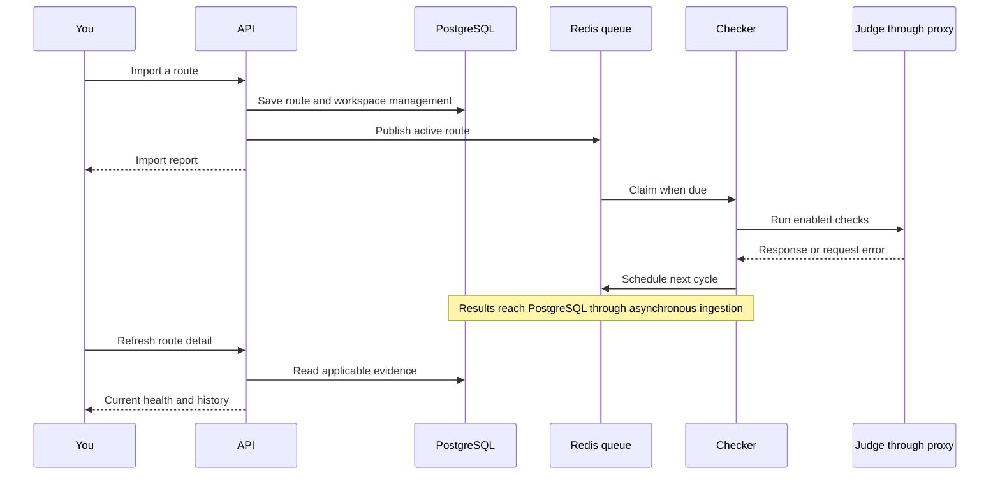

# Your first proxy workflow

You will import a small list, find a check result, pause and restore a managed
proxy, and send a request through a rotating listener. Keep the first run small
so you can tell which result belongs to which input.

Start with a running instance and a signed-in account from the
[quick start](../getting-started/quick-start.md). Use a real proxy you control
or are allowed to use. The examples below are syntax examples and will not
produce working proxy traffic as written.

## 1. Check where your changes will go

Look at the workspace selector in the top bar. Open **Workspace** at
`/workspace` and confirm the workspace name and available capacity. You need
operator, admin, or owner membership to change proxies or checker settings.
Global instance administrator and workspace role are separate permissions.

Open **Checker Settings** at `/checker/settings` and select **Default**. For a
simple first run, enable the protocol supported by your proxy, use TCP
transport, and leave tag rules out of the exercise. The global timer controls
when cycles run; workspace settings control what happens inside them.

Open `/checker/judges` and check that a judge exists for the enabled protocol
and that its validation rule matches the judge's response. Default judges can
be unavailable. When all routes fail against one judge, investigate that judge
before replacing the entire proxy list.

## 2. Import one or two routes

Open **Proxies** at `/proxies`, choose **Add Proxies**, and paste one route per
line. Replace these examples with your own values:

```text
gateway.example.test:8080
alice:secret@gateway.example.test:8080
```

The two lines represent different routes because their credentials differ.
For IPv6, use brackets around the address, such as `[2001:db8::1]:8080`.

Create a tag named `First run` through **Manage tags** and select it for the
import. Choose **Add proxies to queue**. Read the import report for invalid
formats, rejected addresses, and blacklisted entries, then find your routes
in the list using the tag or host search.

Expected result: accepted routes appear in this workspace. Overflow beyond a
finite capacity appears paused. Import acceptance does not establish health,
and the added count does not prove a route was newly created rather than
already known.

## 3. Follow the first check

Open a route's detail page. Check its lifecycle state and recent statistics.
New work is scheduled through Redis and the checker. Initial import scheduling
can spread checks across the global interval, whose embedded default is five
hours. Result persistence is also asynchronous. A large pool does not become
healthy immediately after an upload.

On your own small learning installation, open the active route's Actions menu
in the proxy list and choose **Check now**. This action is visible to instance
administrators. It queues that route for an immediate worker visit and still
uses the normal result pipeline. Integration clients can use the
[per-route requeue API](../api/rest-admin-and-system.md#requeue-one-proxy).
Avoid requeueing an entire large pool just to inspect one route.



When a result appears, identify its protocol, transport, response time, and
whether its configuration is current. `health_known=false` in list responses
means unknown, even though the compatibility `alive` field is false. On detail
responses, unknown health is `alive: null`.

If no result appears, continue with the
[diagnostic workflow](observe-and-troubleshoot.md#no-check-result-after-import).
If a result fails, check the route's credentials and network reachability as
well as the judge and validation rule.

## 4. Pause and restore it

Use the route's Actions menu to **Pause** it. The row, credentials, tags, and
history remain. This workspace stops contributing the route to active checking
and rotation. A check already in progress can still finish.

Choose **Activate** to restore it. Activation requires free active capacity.
Reimporting a paused route preserves its paused state; importing is not a way
to bypass a pause. Archive is another stored, inactive state. Delete removes
this workspace's management and tag assignments.

## 5. Create a rotating listener

Continue once you have an active route with successful current TCP evidence.
Open `/rotating` and create a rotator:

1. Give it a name such as `First run`.
2. Select an available backend instance.
3. Choose HTTP for the listener and TCP transport for this example. Choose an
   upstream protocol that your route supports and Default enables.
4. Start without reputation or uptime restrictions so you can verify basic
   eligibility. You can narrow the pool after that works.
5. Enable listener authentication and choose dedicated client credentials.
   These credentials protect access to Magpie's listener; they are different
   from credentials for an upstream proxy.

Record the allocated listener address and port. Compose publishes
`20000-20100` by default. Use the allocated port, not the dashboard's `5050`
or the API's `5656`. On another machine, use the backend host reachable from
your client. A bind address such as `0.0.0.0` is not a destination address.

For an HTTP listener, test with curl. Replace the port and target URL. Curl
prompts for the password when only the username is supplied:

```bash
curl --fail --show-error --max-time 30 \
  --proxy http://localhost:20000 \
  --proxy-user learner \
  https://example.com/
```

Expected result: you receive the target's response through the selected
upstream. A target failure can still happen after a judge check passed.
The rotator selects for new requests or connections; an established CONNECT
or SOCKS tunnel keeps its upstream for that tunnel's lifetime. Two requests
can select the same upstream when the usable pool has only one route.

If the listener reports an empty pool, check active state, current TCP evidence,
and filters in that order. [Rotation internals](../backend/rotation.md) explains
the exact selection boundary.

<details>
<summary>Checkpoint: why can an imported, active route still be absent from your rotator?</summary>

It might have no committed successful TCP check for this workspace's current
settings. Its protocol may differ from the rotator's upstream protocol, or a
reputation or uptime filter may exclude it. Active is a lifecycle state, not a
health guarantee.

</details>

Next, [build a pool that maintains itself](automate-a-pool.md).
