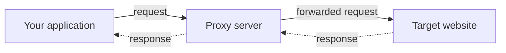
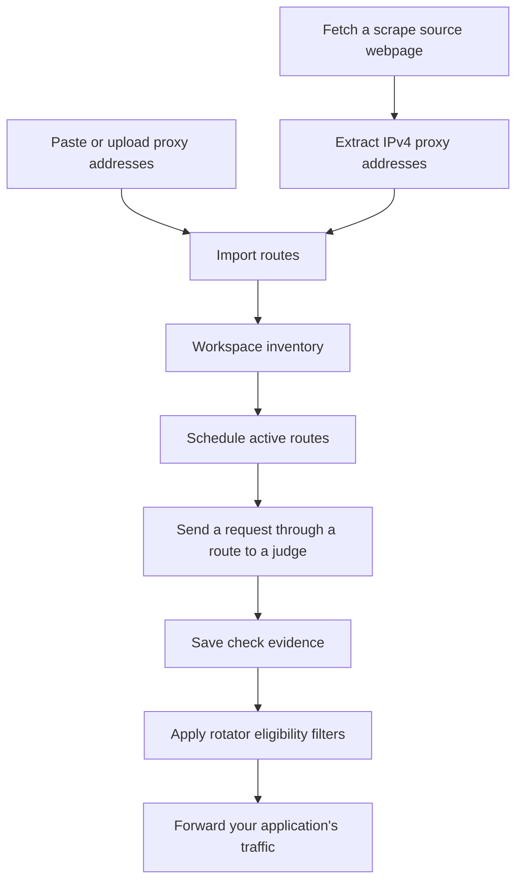
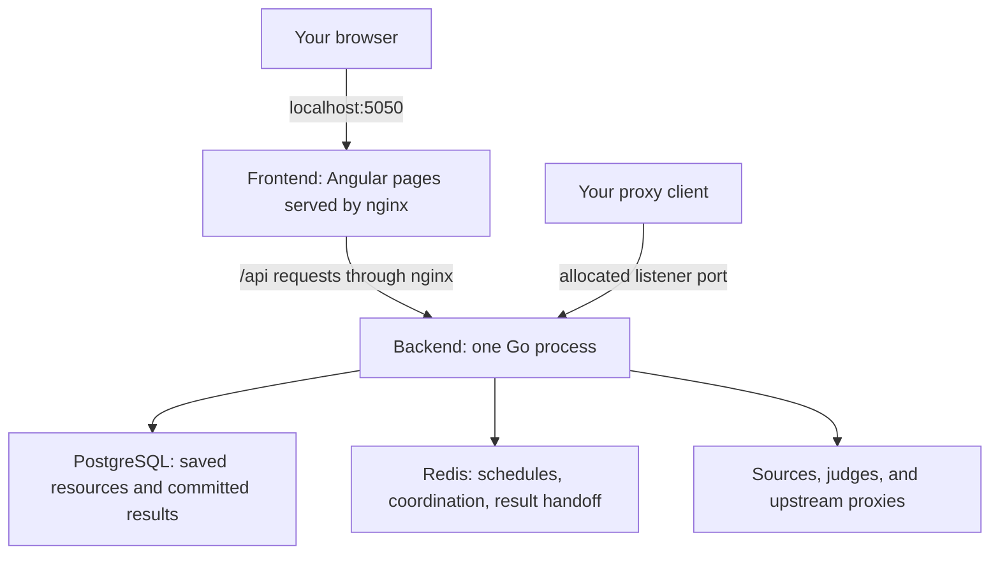

# How Magpie works

A proxy forwards network traffic for another program. Instead of opening a
connection directly to a website, your program connects to the proxy and asks
it to reach the website. The website normally sees the proxy's outgoing address.
Its access rules and the proxy's behavior still determine whether the request
succeeds.

## An address, a route, and a workspace

Take `alice:secret@gateway.example.test:8080`:

| Part | Meaning |
| --- | --- |
| `gateway.example.test` | The host, either a DNS name or an IP address. |
| `8080` | The port where the proxy accepts connections. |
| `alice` and `secret` | Credentials for that upstream proxy. These are separate from your Magpie login. |

Magpie calls the combination of host, port, and exact credentials a **proxy
route**. Different credentials at the same host and port create different
routes. A hostname route stays the same route when its DNS address changes.

A **workspace** owns your proxy collection, tags, sources, checker settings,
rotators, and capacity. Your account accesses it through a membership. The
workspace switcher at the top of the application chooses which collection you
are looking at.

When a workspace adds a route, it creates a **managed proxy**. Two workspaces
can manage the same route with different tags, settings, and lifecycle states.
Pausing it in one workspace does not pause it in the other.

## Discovery, checking, and traffic are different jobs

A **scrape source** is a webpage containing proxy addresses. Fetching it can
succeed even if every proxy on that page is dead. Manual import also supports
hostnames and IPv6; automatic scraping currently extracts IPv4 routes only.

A **judge** is a URL the checker visits through a proxy. Magpie compares the
response with the workspace's validation rule. It can measure response time
and gather evidence about the route. The judge is a test destination, separate
from the websites your application will use.

A **rotating proxy** is a listener opened by Magpie. Your application connects
to that stable host and port. Magpie selects an eligible upstream route and
forwards traffic through it. A rotator does not discover proxies or check one
on demand for each request.

## Protocol is different from the target URL

HTTP, HTTPS, SOCKS4, and SOCKS5 describe ways to talk to a proxy. TCP, QUIC,
and HTTP/3 are transport choices supported in specific Magpie combinations.
Start with TCP when learning the workflow; SOCKS requires it.

An HTTP proxy can carry a connection to an HTTPS website using a CONNECT
tunnel. A target URL beginning with `https://` therefore does not mean that
your proxy protocol must be set to HTTPS. Use the protocol your upstream
actually supports. The listener protocol and upstream protocol can also
differ, as explained in [rotating traffic](../backend/rotation.md).

## What runs on your machine

Docker runs each service in a container, an isolated process with its own
filesystem and network identity. Compose starts the containers together.
Volumes retain data when containers are replaced.

The Go process runs the API, checking and scraping workers, background jobs,
and rotating listeners. They share PostgreSQL and Redis. You do not start a
separate checker container in the default installation.

PostgreSQL is the durable record of resources and committed results. Redis
holds runtime queues and coordination. Redis loss can interrupt checking and
lose results that have not reached PostgreSQL; rebuilding its queue restores
the inventory, not those lost measurements.

## Read state and health separately

| Question | Values | What it tells you |
| --- | --- | --- |
| Should Magpie manage this route actively? | Active, paused, archived | Lifecycle, chosen for this workspace. Only active management consumes active capacity. |
| Did it pass the applicable check? | Alive, dead, unknown | Health for this workspace's current settings. |
| Can this rotator use it? | Eligible or excluded | Active state, matching successful TCP evidence, and the rotator's filters. |

An active proxy can be dead or unknown. A paused proxy can retain old successful
history. Changing checker settings can make health unknown until a new matching
result commits. A reputation label summarizes other evidence and does not
replace current health.

Checkpoint: a source says Scraped, but its proxies have no health data. Is that a contradiction?

No. Scraped describes fetching and processing the webpage. Health requires
eligible checks and saved results for the workspace's current settings. Check
the proxies' lifecycle, judges, settings, and check history next.

Next, [start Magpie](../getting-started/quick-start.md), then follow
[your first proxy workflow](first-proxy.md).
