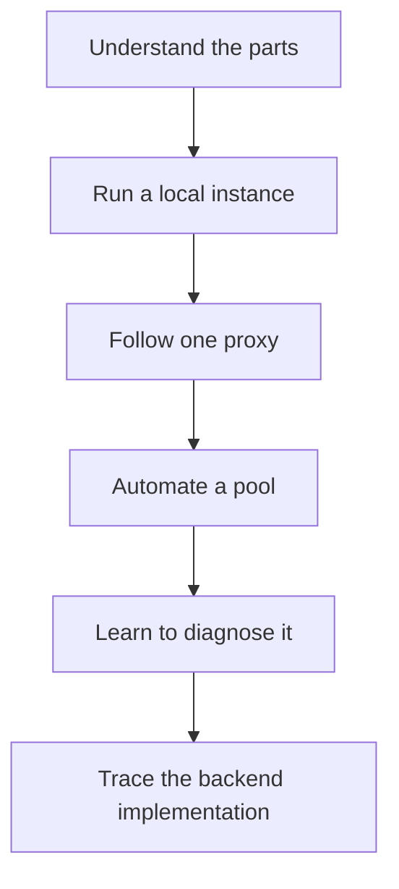

# Learn Magpie in an afternoon

Start here if you have never run Magpie or managed a proxy pool. You do not
need to know Go, Angular, Redis, or PostgreSQL. We introduce each part when it
becomes useful.

By the end, you should be able to explain where a proxy came from, why Magpie
considers it healthy or unknown, and how a client uses a rotating listener.
You will also know where to look when one stage stops working.

## Your route through the docs

These are learning estimates, including the short exercises. Image downloads
and waiting for live checks can take longer.

| Stage | Time | What you will be able to do |
| --- | --- | --- |
| 1. [How Magpie works](how-magpie-works.md) | 15 min | Draw the path from your application to a target through a proxy. |
| 2. [Quick start](../getting-started/quick-start.md) and [first login](../getting-started/first-login.md) | 20 min | Start the services and identify your active workspace. |
| 3. [Your first proxy workflow](first-proxy.md) | 30 min | Import, inspect, pause, and use a route through a rotator. |
| 4. [Build a pool that maintains itself](automate-a-pool.md) | 20 min | Connect sources, tags, checker rules, and alerts. |
| 5. [Observe and troubleshoot](observe-and-troubleshoot.md) | 15 min | Locate a failure in the import, check, result, or traffic stage. |
| 6. [Backend internals](../backend/index.md) | 60 min | Trace the same workflow through the Go code and its storage boundaries. |

The full path is about 2 hours 40 minutes. Stages 1 through 5 form the user introduction.
You can return to the backend section later.

## What you need for the exercises

- A computer with Docker and Compose, or access to a Magpie installation.
- An account with workspace operator access for imports and settings changes.
  The first local account has the access needed for this walkthrough.
- For live checks and rotation, at least one working proxy you are allowed to
  use, plus a reachable judge. Magpie's installer does not supply a working proxy.

You can read the full path without a proxy. Address examples use reserved
domains and documentation IP ranges and demonstrate syntax only. Replace them
with your own values before trying live traffic.

For a populated development UI without live proxies, the
[development fixtures](../getting-started/local-development.md#restore-development-test-data)
provide simulated health, sources, and alerts. This requires a source checkout.
Fixture mode stops live jobs and listeners, so use it to explore screens rather
than to test checking or traffic.

## How to use each lesson

Read the diagram, follow one small workflow, then answer the checkpoint at the
end. Answers sit inside expandable sections. If a term is unfamiliar, use the
[glossary](glossary.md). You do not need to read the API tables in order.

Start with [How Magpie works](how-magpie-works.md).
