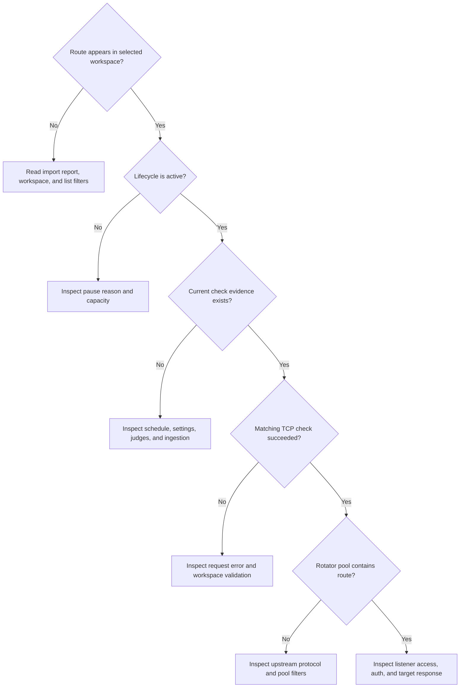

# Observe and troubleshoot

Start with one route in one workspace. Record its ID, lifecycle, selected
checker protocols, and last result time. Those details tell you which stage
to inspect. Changing several settings at once makes that evidence harder to
interpret.



## No check result after import

1. Confirm you selected the right workspace and cleared filters that hide
   unknown or inactive routes.
2. Open the route detail. A paused capacity overflow is stored but not checked
   for that workspace. A paused reimport stays paused.
3. Check the global interval. Initial imported work can be spread across that
   interval. An administrator can choose **Check now** in the active route's
   Actions menu to investigate sooner.
4. Check the workspace's effective protocols and judges. An empty protocol
   selection or no eligible judge can produce no check attempts.
5. Check readiness and backend logs. A missing queue or unavailable Redis can
   stop scheduling. Startup queue reconstruction can still be in progress.
6. If workers are completing checks but history stays empty, inspect statistics
   ingestion and database errors. A completed network request is not a
   committed result. Batches normally flush at 5,000 results or a 15-second
   timer per consumer worker, with additional delays during failures or load.

## Health became unknown after a settings change

Unknown means the workspace lacks applicable evidence for its current settings,
or the settings projection has not finished refreshing. A previous success
with a different judge rule, timeout, transport, or retry count cannot define
the new health. Historical rows remain visible.

Wait for the settings refresh and a matching check. Inspect configuration
metadata in history before treating an old success as proof of current health.
If no checks are enabled, unknown can persist until you enable one.

## The dashboard and route details disagree briefly

Route evidence, reputation, source counts, and dashboard aggregates have
different update paths. History and latest evidence commit together, while
derived read models and caches refresh afterward. A **read model** is a saved
or cached view shaped for fast reads, such as the counts on a source page.

Use the route's attributed history to inspect an individual check. Use
dashboards for trends. A long or growing delay calls for inspecting ingestion
and read-model refresh failures, rather than repeatedly importing the route.

## A healthy route is missing from rotation

Compare the rotator's upstream protocol with the route's current TCP evidence
in the same workspace. Then inspect reputation and uptime filters. QUIC or
HTTP/3 checker success cannot qualify the current TCP upstream connections.
Another workspace's success cannot qualify this one either.

If the pool is eligible but curl cannot connect, inspect the allocated listener
port, selected instance, published Docker ports, firewall, listener protocol,
and listener authentication. If the listener connects but the target refuses
the request, inspect the upstream and target response.

## Inspect the local stack

Run these from the distribution repository or installer directory containing
your Compose files. Preserve the same production/custom overlay selection
used when starting the stack.

```bash
docker compose ps
docker compose logs --tail=100 backend
curl --fail --show-error http://127.0.0.1:5656/readyz
```

`/healthz` reports process liveness. `/readyz` also considers PostgreSQL, Redis
policy, and queue bootstrap. With default readiness policy, Redis failure means
the service is not ready. Observability requests may need an
`X-Observability-Token` when they do not arrive over a trusted loopback path.
See [observability access](../operations/troubleshooting.md#403-forbidden-on-healthz-readyz-or-metrics).

For a useful issue report, include the Magpie version, approximate timestamps,
workspace and route IDs, current settings, and the first relevant error.
Remove passwords, tokens, proxy credentials, and webhook targets from shared
output. The [troubleshooting reference](../operations/troubleshooting.md) covers
specific HTTP errors and deployment problems.

<details>
<summary>Checkpoint: Redis queues were rebuilt. Does that recover every check result?</summary>

No. Queue reconstruction reloads active inventory from PostgreSQL. Results
lost before the statistics transaction committed cannot be recreated by
reloading inventory. Redis stream persistence and overload policy determine
which uncommitted results remain replayable.

</details>

You have finished the user learning path. Continue with
[backend internals](../backend/index.md) to understand the implementation.
