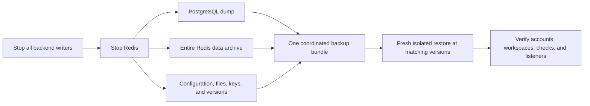

# Backup and recovery

A recoverable Magpie backup contains matching PostgreSQL and Redis state plus
the configuration and keys that interpret it. A database dump alone leaves out
queue schedules, stream progress, and session revocations.

This runbook uses Bash and the bundled Compose services. It requires a maintenance
window and enough disk space for the dump and archives. For managed databases,
use the provider's backup tools while preserving the same coordination and
verification requirements.

## What belongs together

| Item | Why you need it |
| --- | --- |
| PostgreSQL database | Accounts, workspace memberships and ownership, lifecycle state, capacity, usage, settings, history, and outboxes. |
| Entire Redis data volume | Corresponding workspace queue payloads, schedules, streams, and runtime state. |
| `PROXY_ENCRYPTION_KEY` | Decrypts stored credentials and preserves keyed route identities and legacy encrypted queue payloads. |
| JWT signing material | Explicit `JWT_SECRET`, or `/app/data/jwt_secret` in `backend_data` when generated automatically. |
| Backend data and separately mounted settings | Restores persistent files used by this installation. |
| `.env`, ordered Compose files, image versions, mounted certificates and other external configuration | Recreates the same service behavior and storage selection. |

PostgreSQL encrypts proxy usernames and passwords at the application layer.
Proxy hosts remain queryable. Redis queue credentials are plaintext by default.
Encrypt exported backups and snapshots, restrict who can read them, and keep
recovery keys available independently of the failed machine.

The examples below create private local files; they do not encrypt the bundle.
Apply your backup system's encryption before copying it off the host.



## Prepare the maintenance window

1. Use the installation directory and the same Compose project/file selection
   used for normal operation. Persist the full `COMPOSE_FILE` list if needed.
2. Record the backend and frontend tags or digests. Retain those images in your
   registry or recovery store.
3. Stop other backend replicas and any external tools that write to these
   PostgreSQL or Redis services. The commands below stop only this project's
   backend.
4. Tell users that API and rotating listener access will pause. Wait for graceful
   backend shutdown before capturing data.

Do not change keys or run a schema migration between the two captures.
Choose a backup location outside Docker volumes:

```bash
umask 077
backup_dir="backups/$(date -u +%Y%m%dT%H%M%SZ)"
mkdir -p "$backup_dir"
cp .env "$backup_dir/deployment.env"
cp docker-compose.yml "$backup_dir/"
docker compose images > "$backup_dir/images.txt"
```

Copy every other selected Compose file, mounted configuration, and external key
file into this bundle as well. In a production installation that includes
`docker-compose.production.yml`, copy that file too. Avoid storing only the
rendered configuration, because you also need the original file order and paths.

## Capture and check the backup

Run this block in the same shell, where `backup_dir` is set. It exits on the
first failed command and leaves services stopped for inspection if a capture
or archive check fails.

```bash
(
  set -e
  verify_stopped() {
    container_id="$(docker compose ps --all -q "$1")"
    test -n "$container_id"
    test "$(docker inspect --format '{{.State.Running}}:{{.State.ExitCode}}:{{.State.OOMKilled}}:{{.State.Error}}' "$container_id")" = 'false:0:false:'
  }
  docker compose stop backend
  verify_stopped backend
  docker compose stop redis
  verify_stopped redis

  docker compose exec -T postgres sh -c \
    'pg_dump -U "$POSTGRES_USER" -d "$POSTGRES_DB" -Fc' \
    > "$backup_dir/postgres.dump"

  docker compose run --rm --no-deps -T --entrypoint tar redis \
    -C /data -czf - . > "$backup_dir/redis-data.tgz"

  docker compose run --rm --no-deps -T --entrypoint tar backend-volume-init \
    -C /app/data -czf - . > "$backup_dir/backend-data.tgz"

  test -s "$backup_dir/postgres.dump"
  docker compose exec -T postgres pg_restore --list \
    < "$backup_dir/postgres.dump" > "$backup_dir/postgres-contents.txt"
  tar -tzf "$backup_dir/redis-data.tgz" > "$backup_dir/redis-contents.txt"
  tar -tzf "$backup_dir/backend-data.tgz" > "$backup_dir/backend-contents.txt"

  docker compose up -d redis backend
)
```

PostgreSQL stays running for the logical dump. Its
[custom archive format](https://www.postgresql.org/docs/17/app-pgdump.html)
works with `pg_restore`. Application writers must remain stopped so the
PostgreSQL state matches the frozen Redis state.
`docker compose stop` completing does not prove that the application drained
successfully. The exit-state checks above reject a nonzero exit, a forced stop,
or an out-of-memory kill before any backup is captured.

The Redis helper runs `tar` against the stopped volume without starting Redis.
Archive the entire `/data` directory. Redis 7 uses multipart append-only files;
copying only `dump.rdb` or one AOF file can omit durable state. See
[Redis persistence](https://redis.io/docs/latest/operate/oss_and_stack/management/persistence/).

The backend helper similarly archives `/app/data`; it does not start the
backend. Chromium cache is normally rebuildable. Copy any custom persistent
mounts separately.

After restart, check service state and readiness. If a command failed, diagnose
it before deciding whether to resume service or repeat the backup. Keep failed
captures separate from verified bundles.

## Restore into a fresh installation

Use an isolated host or a deployment configured with fresh, empty volumes and
nonconflicting container names and ports. Do not test recovery over the only
live copy of your data.

Restore the original Compose files, their ordered selection, and `.env` from the
bundle. Use the original keys and matching component versions. Preserve relative
paths for mounted files. Start with the application backend stopped.

Set the path to the recovered bundle:

```bash
backup_dir=/absolute/path/to/recovered-backup
```

Start only PostgreSQL:

```bash
docker compose up -d postgres
docker compose exec -T postgres sh -c \
  'pg_isready -h 127.0.0.1 -U "$POSTGRES_USER" -d "$POSTGRES_DB"'
```

Wait until the TCP readiness command succeeds, then restore. PostgreSQL's
temporary initialization server can answer over its Unix socket before the
final server is ready. The destination
database must be fresh. This is a single-database restore; installations with
custom PostgreSQL roles, tablespaces, or extension requirements need those
prerequisites restored by their database administrator.

```bash
(
  set -e
  docker compose exec -T postgres sh -c \
    'pg_restore --exit-on-error --no-owner --no-privileges -U "$POSTGRES_USER" -d "$POSTGRES_DB"' \
    < "$backup_dir/postgres.dump"

  docker compose run --rm --no-deps -T --entrypoint tar redis \
    -C /data -xzf - < "$backup_dir/redis-data.tgz"

  docker compose run --rm --no-deps -T --entrypoint tar backend-volume-init \
    -C /app/data -xzf - < "$backup_dir/backend-data.tgz"

  docker compose up -d
)
```

The restore uses the destination database role for object ownership and skips
source ACLs, which suits the bundled single-role stack. See the
[`pg_restore` options](https://www.postgresql.org/docs/17/app-pgrestore.html).
A failed restore may leave partial data. Keep the backend stopped, inspect the
error, and prepare a fresh destination before retrying.

## Repair derived state after an interrupted shutdown

A failed shutdown can leave proxy filters and source counters behind the
durable results in PostgreSQL. Dirty notifications are held in memory; ordinary
startup does not rescan every nonempty projection. Keep all backend replicas
and external writers stopped, preserve the failed-state evidence, and use the
matching backend image with the existing schema and `PROXY_ENCRYPTION_KEY`:

```bash
docker compose run --rm --no-deps backend --rebuild-read-models
```

Retain the installation's usual Compose file selection, including its production
overlay. By default, this command rebuilds proxy filters in pages of up to 5,000
ownership pairs; source counters use pages of up to 100 pairs. It does not start the API,
Redis clients or background jobs, migrate the schema, or seed defaults. It
requires the existing encryption key. SIGINT, SIGTERM and database failures
return an error; already completed pages remain applied, and the command can be
rerun from the beginning.

The repair also removes derived filter and source-counter rows whose ownership
no longer exists. Candidate pages are bounded before checking ownership, so
cleanup does not rescan the full derived tables for every page. Authoritative
routes, ownership, credentials and result history are preserved.

Start the backend only after the command exits successfully, verify current
checks and filters, then repeat the coordinated shutdown and backup. Repairing
derived state does not establish that a previous failed backup was clean or
recover volatile results that never reached PostgreSQL.

Do not run a new version's migration before restoring an older schema. Recover
at matching versions first; perform a separate, backed-up
[update](../getting-started/updating.md) after verification.

## Prove the recovery works

Before starting a rehearsal backend, control its outbound network access and
listener exposure. A restored outbox or alert delivery can send a message again,
and restored sources can resume scraping.

Check these against notes taken before the backup:

- Sign-in succeeds and workspace memberships, roles, and default selection match.
- Active, paused, and archived proxy counts match. Paused and archived routes
  remain absent from checker and rotating listener work.
- Credentials still decrypt. A fresh check produces a result for the intended
  workspace and current settings.
- Sources, tags, judges, rotators, capacity limits, and settings are present.
- A rotating listener accepts a test client with the expected authentication.
- Pending mail and alert deliveries behave as expected; account for possible
  duplicate delivery when resuming restored work.

A readable archive is only the first check. Record the date and result of a
successful restore rehearsal. Measure how much data could be lost between
backups, your recovery point objective, and how long verified recovery takes,
your recovery time objective. Use those measurements to choose backup frequency
and retention.

The distribution repository's
[`isolated rehearsal`](https://github.com/Magpie-Tools/magpie/tree/master/scripts/recovery)
automates this procedure for disposable Linux Docker services. It stops writers,
captures the coordinated bundle, removes its original volumes, restores fresh
volumes, and verifies stored state plus application behavior. Its default dataset
has one million imported authenticated routes shared across eight workspaces.
The workflow also checks persistent JWT material, revoked sessions, decrypted
credentials, and an authenticated rotating listener against a controlled judge.
It retains a result file, timings, and raw command logs. This is a local capacity
and recovery baseline; rehearse the production storage and configuration profile
before claiming the same recovery time for a live installation.

## If the original encryption key is missing

Recover `PROXY_ENCRYPTION_KEY` from the original secret store or encrypted
configuration backup. A newly generated key cannot decrypt the old credentials
or preserve their keyed identities. Keep the damaged installation and its
backups intact while locating the original key.
