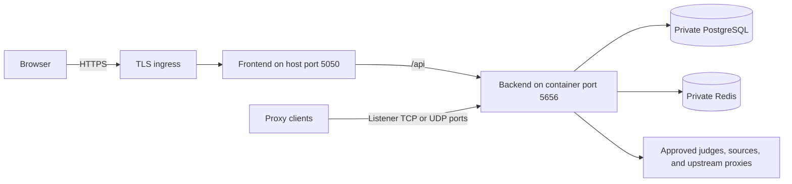

# Deployment

The distribution repository supplies a Docker Compose stack with a frontend,
backend, PostgreSQL, and Redis. Start with [Installation](../getting-started/installation.md)
for the first launch. This page explains the decisions that turn that local
stack into an operated service.

## Choose the deployment shape

| Situation | Starting point | What you must decide |
| --- | --- | --- |
| Trying Magpie on your own computer | Base `docker-compose.yml` | Strong secrets, persistent data, and who can reach port 5050. |
| A team accesses Magpie over HTTPS | Base file plus `docker-compose.production.yml` | Ingress/TLS, exact browser origin, registration policy, monitoring, and backups. |
| Multiple backend instances | Shared PostgreSQL and Redis plus custom deployment configuration | Shared secrets and queue settings, unique instance identities, listener routing, and coordinated upgrades. |

The production overlay enables strict validation, disables public registration
and first-admin bootstrap, protects observability endpoints, and sets
`DB_AUTO_MIGRATE=false`. It does not configure HTTPS, Redis authentication,
or your host firewall. Those belong to the deployment configuration.

## Understand the network paths



The bundled host port mappings are:

| Service | Host binding | Container port | Operator action |
| --- | --- | --- | --- |
| Frontend | All interfaces, `5050` | `80` | Put behind TLS ingress and restrict direct public access as needed. |
| Backend API | `127.0.0.1:5656` | `5656` | Keep the loopback default unless a controlled ingress needs another binding. |
| PostgreSQL | `127.0.0.1:5434` | `5432` | Keep private. Backend containers connect to `postgres:5432`. |
| Redis | `127.0.0.1:8946` | `6379` | Keep private. Backend containers connect to `redis:6379`. |
| Rotating listeners | All interfaces, `20000` through `20100`, TCP and UDP | Same range | Restrict client networks and configure listener authentication. |

Website HTTPS does not secure arbitrary rotating proxy protocols. Configure and
test listener transport, credentials, and firewall rules separately. Changing
`ROTATING_PROXY_PORT_START` or `ROTATING_PROXY_PORT_END` also requires matching
published ports in a Compose overlay.

## Prepare production settings

Keep the full ordered Compose selection consistent. On macOS/Linux, a production
installation can persist it in `.env`:

```dotenv
COMPOSE_FILE=docker-compose.yml:docker-compose.production.yml
COMPOSE_PROJECT_NAME=magpie-production
MAGPIE_ENV=production
```

Use `;` as the file separator on Windows. Add custom overlays to the list.
Changing the project name later selects a different set of named volumes.

Before opening access:

- Set a strong, stable `PROXY_ENCRYPTION_KEY`. Keep it with encrypted recovery
  material. The installer generates `JWT_SECRET`; a single backend can instead
  persist its automatically generated signing key in `/app/data/jwt_secret`.
  Multiple instances must share an explicit signing secret.
- Set a unique `DB_PASSWORD` before PostgreSQL initializes its volume.
  Changing `.env` later does not change an existing database role's password.
- Set Redis authentication and restrict service access. The base stack supports
  `REDIS_PASSWORD`; a remote Redis service also needs TLS and suitable ACLs.
- Configure `CORS_ALLOWED_ORIGINS` with the exact public browser origin and
  `PUBLIC_APP_URL` with the public application URL if using email.
- Configure `TRUSTED_PROXY_CIDRS` for your ingress addresses. Trust only proxies
  whose forwarding headers you control.
- Set an `OBSERVABILITY_TOKEN` for remote probes and establish a backup schedule.

See [Security](./security.md) for the trust boundaries and
[Apply a setting](../reference/environment-variables.md#apply-a-setting) for
variables that need explicit forwarding into a container.

## Migrate, then start

Run from the `magpie` distribution directory with the selected `.env` and files.
For a fresh installation:

```bash
(
  set -e
  docker compose -f docker-compose.yml -f docker-compose.production.yml run --rm backend --migrate-only
  docker compose -f docker-compose.yml -f docker-compose.production.yml up -d
)
```

For an existing installation, take a coordinated backup and stop **all** backend
instances before the migration. Follow [Updating](../getting-started/updating.md)
so the failure path keeps writers stopped. Do not leave automatic migrations
enabled on production application instances.

For the first production account, restrict access to the frontend, temporarily
enable `ENABLE_PUBLIC_FIRST_ADMIN_BOOTSTRAP=true`, and recreate the backend.
Register the first administrator, then disable the flag and recreate again
before opening access. [First login](../getting-started/first-login.md) walks
through that sequence.

## Confirm the deployment works

Check service state and recent startup logs:

```bash
docker compose ps
docker compose logs --tail=100 backend
```

Verify readiness through the actual network path your monitor will use.
A request to a host loopback port can reach the container with a Docker bridge
source address, so production monitoring may still need the observability token.
Sign in through HTTPS, import a test proxy, wait for a check, and connect through
one configured rotating listener. See the [first proxy walkthrough](../learn/first-proxy.md).

CPU and memory limits are supplied per service. Tune the `*_CPU_LIMIT`,
`*_MEMORY_LIMIT`, `*_CPU_RESERVATION`, and `*_MEMORY_RESERVATION` variables using
measurements. Run the [performance validation gate](./performance-validation.md)
before scaling the installation to your target workload.

## Multiple backend instances

All instances share PostgreSQL, Redis, `PROXY_ENCRYPTION_KEY`, and the explicit
JWT secret. Keep queue shard counts and payload settings consistent. Redis
leases coordinate checker work and leader jobs; the PostgreSQL email outbox
allows multiple instances to claim deliveries concurrently.

Set each backend's identity:

| Variable | Purpose |
| --- | --- |
| `MAGPIE_INSTANCE_ID` | Stable, unique instance ID. |
| `MAGPIE_INSTANCE_NAME` | Label displayed in the UI. |
| `MAGPIE_INSTANCE_REGION` | Region displayed for listener placement. |

Each instance reconciles its rotating listeners, by default every ten seconds.
`ROTATING_PROXY_SYNC_INTERVAL_SECONDS` changes that interval. Client traffic
must reach the instance and port that owns the chosen listener. A generic web
load balancer does not provide this routing automatically.

The base Compose file has fixed container names and host ports. It is a
single-stack starting point; `docker compose up --scale backend=2` alone does
not create a working multi-instance deployment. Supply deployment configuration
that handles names, networking, persistent storage, and port ownership.

## Persistent data and permissions

| Volume | Contains | Recovery value |
| --- | --- | --- |
| `postgres_data` | Accounts, workspace resources, encrypted proxy credentials, history, settings, and outboxes. | Authoritative database state. |
| `redis_data` | Queue payloads and schedules, leases, streams, revocations, and runtime coordination. | Must match the database backup. |
| `backend_data` | Backend files, including an automatically generated JWT key. | Preserve with configuration and secrets. |
| `backend_browser_cache` | Chromium-related runtime cache. | Usually rebuildable. |

The backend runs as UID/GID `65532` in a distroless image. It has no general
shell for maintenance commands. The one-shot `backend-volume-init` service
repairs data/cache volume ownership before startup. Custom bind mounts must be
writable by `65532`; use mode `0700` for private data directories.

## Allow graceful shutdown

On SIGTERM, the API drains first. The backend then stops producers, waits for
checker/scraper workers and rotating clients, and lets usage/statistics consumers
finish their final flush. Once statistics and reputation writers stop, read
models refresh proxy filters and drain queued source-statistics batches before
Redis closes.

The API drain allows 20 seconds and background shutdown allows another 60 seconds.
`BACKEND_STOP_GRACE_PERIOD` defaults to `90s`. Keep the Compose grace period
longer than the sum of `SERVER_SHUTDOWN_TIMEOUT_SECONDS` and
`BACKGROUND_SHUTDOWN_TIMEOUT_SECONDS` when tuning them. Pending Redis stream
entries can replay; a failed in-memory statistics flush has no durable recovery.

For a backend image release, run the disposable startup regression from the
`magpie` repository:

```bash
scripts/validate-container-startup.sh kuuchen/magpie-backend:YOUR_TAG
```

It verifies fresh production volumes, repair of old root ownership, persistent
automatic JWT keys, and graceful exit. It is a release check, not a command
needed for every routine restart.
