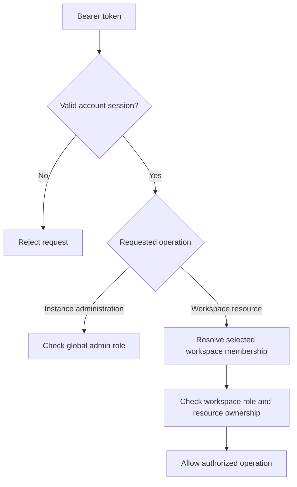

# Security

Magpie holds proxy credentials and can make outbound network requests. Protect
the services that store those credentials, restrict who can change operational
settings, and control where backend traffic can go. The
[deployment guide](./deployment.md) turns these boundaries into a running stack.

## Know where data is readable

| Location | Proxy hosts and ports | Proxy usernames and passwords | Protection to provide |
| --- | --- | --- | --- |
| PostgreSQL | Queryable, including an `inet` projection for literal IP routes. | Authenticated ciphertext on each workspace's managed-proxy row. | Private networking, restricted roles, transport protection as required, encrypted storage and backups. |
| Redis queue | Queryable runtime payloads. | Plaintext by default. | Private networking, authentication, restricted ACLs, TLS for remote access, encrypted volumes and backups. |
| Authorized API responses and exports | Returned when the request needs them. | Can be returned to an authorized workspace user. | HTTPS, suitable workspace roles, protected client logs and exported files. |
| Backup bundle | Contains the captured service data and configuration. | Redis and configuration can contain readable secrets. | Encryption, restricted access, and a tested key recovery process. |

Redis is trusted runtime infrastructure. `PROXY_QUEUE_ENCRYPT_CREDENTIALS=false`
is intentional: the default checker reuses the stored route hash and performs
no credential cryptography on every dequeue. Normal requeues update scheduling
state without rewriting the payload.

`PROXY_QUEUE_ENCRYPT_CREDENTIALS=true` opts into credential encryption for new or
changed queue payloads and adds decryption cost on dequeue. It does not encrypt
all Redis data or replace network and storage controls. Measure the enabled
profile at your target throughput before choosing it. See
[queue internals](../backend/queue-and-leases.md) and the
[backend ADR](https://github.com/Magpie-Tools/magpie-backend/blob/main/docs/adr/0002-keep-hot-proxy-credentials-plaintext-in-redis.md).

## Keep secrets stable and recoverable

| Secret | What depends on it | Operational rule |
| --- | --- | --- |
| `PROXY_ENCRYPTION_KEY` | PostgreSQL credential decryption, keyed route hashes, and legacy encrypted queue payloads. | Generate once and preserve across updates, replicas, and restores. |
| `JWT_SECRET` | Acceptance of signed login tokens. | Share one explicit value across replicas. A change invalidates tokens signed with the previous value. |
| `/app/data/jwt_secret` | Persistent generated signing key when an explicit JWT secret is absent. | Back up `backend_data`; do not treat the container's writable layer as persistence. |
| Database, Redis, SMTP, observability, and webhook secrets | Service access and external integrations. | Store privately, scope access, and update dependent clients when changing them. |

The installer generates a unique JWT secret in `.env`. A backend without one
generates a 256-bit signing key and persists it in `/app/data/jwt_secret`.
The obsolete published Compose JWT default is replaced by a generated key,
invalidating sessions signed with that old value.

Use `STRICT_SECRET_VALIDATION=true` in production. Keep exported configuration
and secrets out of source control and application support logs. Follow
[Backup and recovery](./backup-and-recovery.md) before changing persistent state.

## Separate account and workspace permissions

A JWT authenticates an account. A workspace-scoped request must also resolve a
membership from `X-Workspace-ID` or the account's default membership. A global
instance administrator does not automatically become a workspace member.

Keep public registration disabled for a private installation. Enable
`ENABLE_PUBLIC_FIRST_ADMIN_BOOTSTRAP=true` only during a controlled first-account
window, then disable it and recreate the backend. Rate limits protect login,
registration, and recovery; keep the defaults unless measurements justify a
change.

Registration, password change, and reset enforce the same password policy.
Email identities are normalized and enforced case-insensitively. See
[API authentication](../api/authentication.md) for token handling and workspace
role requirements.

## Decide what a Redis outage means for sessions

Logout, password change, password reset, and account deletion revoke existing
sessions through Redis under normal revocation-store operation.
`AUTH_REVOCATION_FAIL_OPEN=true` is the default. During a Redis outage,
a correctly signed token can remain accepted even when its revocation status
cannot be checked.

Set `AUTH_REVOCATION_FAIL_OPEN=false` when the deployment requires rejection of
requests whose revocation status is unavailable. Provide Redis availability
appropriate to that choice. This setting needs explicit container forwarding
if your Compose file does not list it; follow
[Apply a setting](../reference/environment-variables.md#apply-a-setting).

## Protect recovery and invitations

Password reset links use the fixed `PUBLIC_APP_URL`, not an incoming Host header.
Tokens are random, single use, short lived, and stored as hashes. A new reset
request replaces the previous token, and a successful reset removes outstanding
reset tokens. Request-volume and account-identifier limits both apply; the
default forgot-password limit is one request per email per minute.

Workspace invitations are bound to an existing recipient account ID. Only that
signed-in account can accept or decline. The notification URL contains no
bearer token, so forwarding it does not transfer the invitation.

The invitation row is authoritative. Acceptance creates membership and removes
the offer in one transaction. Decline, revoke, and expiry cleanup also remove
pending rows. A unique constraint permits one pending invitation per workspace
and recipient. Email failure neither grants membership nor removes the offer.
Owners can manage every invitation role and billing access; workspace admins
can invite only operators/viewers without billing access.

Recovery, confirmation, and invitation emails use a durable PostgreSQL outbox.
Delivery requires TLS: port 587 must complete STARTTLS before authentication
or submission, and port 465 uses implicit TLS. Set `SMTP_USERNAME` and
`SMTP_PASSWORD` together or leave both unset.

## Restrict inbound connections

Put the browser application behind HTTPS ingress. Keep `CORS_ALLOWED_ORIGINS`
specific to the origins you serve. CORS is a browser request rule; it does not
replace authentication, firewall rules, or listener access controls.

Configure `TRUSTED_PROXY_CIDRS` only for ingress networks you control. Otherwise
client IP extraction can either ignore legitimate forwarding headers or trust
spoofed ones. Avoid wildcard trust ranges such as `0.0.0.0/0`.

Keep security headers enabled with `SECURITY_HEADERS_ENABLED=true`.
Restrict PostgreSQL and Redis to private service networks. For remote
PostgreSQL, choose a TLS mode appropriate to the trust model: `require`
encrypts the connection, while `verify-full` also verifies the server's
certificate chain and hostname using a trusted CA. See
[PostgreSQL TLS modes](https://www.postgresql.org/docs/17/libpq-ssl.html).

Rotating listener ports are a separate entry point from the website. Use
listener authentication, allowed client networks, and the transport configuration
required by the selected protocol.

## Protect monitoring endpoints

In production, `/healthz`, `/readyz`, and `/metrics` accept loopback source
requests or a matching `X-Observability-Token` by default. Set
`OBSERVABILITY_TOKEN` for a monitor that reaches the backend over the network.
A host loopback connection forwarded through Docker can appear as a non-loopback
source inside the container.

`ALLOW_PUBLIC_OBSERVABILITY_ENDPOINTS=true` explicitly permits public probes.
Prefer a private monitoring path or token rather than exposing internal health
and metrics to every client.

## Control outbound destinations

Judges, scrape sources, blacklist downloads, and other outbound requests can
reach addresses supplied through configuration. The default policy blocks
private, loopback, and reserved destinations. Website blacklist rules can also
reject URLs and remove existing blocked relations.

For browser scraping, each context uses a restricted local proxy. It resolves
the hostname, rejects unsafe answers, and dials the validated literal address.
Chromium has no direct fallback or loopback bypass for that context. The guard
covers redirects, frames, workers, subresources, and HTTPS CONNECT tunnels.
Checking the response address after a request would be too late.

Chromium's [proxy documentation](https://chromium.googlesource.com/chromium/src/+/HEAD/net/docs/proxy.md)
explains proxy-side resolution and loopback bypass rules.
`ALLOW_PRIVATE_NETWORK_EGRESS=true` deliberately changes the policy for private
sources and other application outbound requests. Use it only when the backend's
network and the people configuring destinations are trusted to reach those
services.
