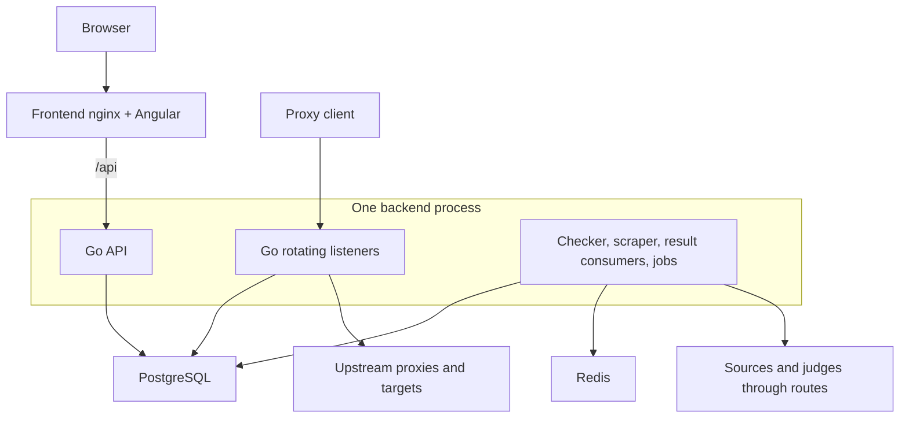

# Architecture

For a guided explanation with checkpoints and source links, read
[backend internals](../backend/index.md). This page is the short system reference.

Magpie is a multi-component system:

- Go `1.27.3` API server (`internal/app/server` in `magpie-backend`)
- background job routines (`internal/jobs/*` in `magpie-backend`)
- rotating proxy listener manager (`internal/rotatingproxy` in `magpie-backend`)
- Angular `21` frontend (`src/app` in `magpie-frontend`)



## Startup flow

At startup, backend:

1. Loads environment, production policy, and required secrets.
2. Attempts Redis connection and starts the instance heartbeat.
3. Loads `data/settings.json` or embedded defaults and connects PostgreSQL.
4. Initializes blacklists, judges, compiled checker snapshots, and saved-state reconciliation.
5. Launches queue reconstruction, asynchronously by default, and queue-loss monitoring.
6. Starts assigned rotating listeners, workers, consumers, and periodic jobs.
7. Opens the API. Readiness waits for dependencies and queue-bootstrap policy.

`--migrate-only` runs database migrations and exits before runtime startup.
See [startup and shutdown](../backend/startup-and-lifecycle.md) for failure,
recovery, and ordered shutdown behavior.

## API style

- REST endpoints mounted under `/api`
- GraphQL endpoint mounted at `/api/graphql`
- authenticated resource requests resolve a workspace membership from
  `X-Workspace-ID`, or from the account's default workspace when omitted

## Ownership model

The ownership path is deliberately singular:

```text
User account
  └─ Workspace membership
       └─ Workspace
          ├─ Managed proxy routes
          ├─ Tags, judges, sources, and rotators
          ├─ Members and roles
          ├─ Pending account-bound invitations
          ├─ Subscription
          └─ Capacity and usage
```

Accounts retain login identity, password, global instance role, and
user-per-workspace display preferences. Operational resources and settings
belong to a workspace. A member leaving changes authorization only; it does
not remove resources or reduce capacity.

Workspace invitations are the pre-membership state. They reference an existing account, grant no access until accepted, and remain workspace-owned if their inviter leaves. Email is a best-effort notification through the durable outbox; the authenticated `/invitations` inbox and PostgreSQL row are authoritative.

`Organization` is reserved for a future consolidated-billing and SSO parent
of multiple workspaces. `Team` is reserved for a future permission group
inside a workspace. Neither is part of the current ownership path.

## Storage model

- PostgreSQL stores accounts, memberships, workspaces, managed proxies,
  lifecycle state, entitlements, usage periods, statistics, reputations,
  sources, and rotators
- Redis provides queue/coordinator features used by runtime routines

The checker hands results to a Redis statistics stream or volatile memory
fallback. PostgreSQL commits history, latest workspace evidence, replay
identities, and counters together. Derived reputation, source counts, and
dashboards can refresh later. [Results and replay](../backend/results-and-storage.md)
explains these boundaries.

The global proxy-route row represents a host, port, and credential identity.
The workspace association is a managed proxy and holds encrypted credentials,
lifecycle and failure state, and tag relationships. Redis queue payloads carry
the active workspace IDs already needed by checker fan-out. Check-attempt usage
is aggregated when the existing asynchronous statistics batch is flushed, so
workspace metering does not add a database query to each proxy check.

Rotator request and payload-byte usage follows the same performance principle:
listeners increment in-memory monthly counters and a background routine writes
aggregate deltas. HTTP requests and established CONNECT/SOCKS tunnels count as
managed requests; bytes count request/response or bidirectional tunnel payload,
excluding protocol headers.

See the backend decision record
`docs/adr/0005-make-workspaces-the-ownership-and-capacity-boundary.md` for the
ownership trade-offs and `docs/adr/0006-use-account-bound-workspace-invitations.md`
for the invitation model.
