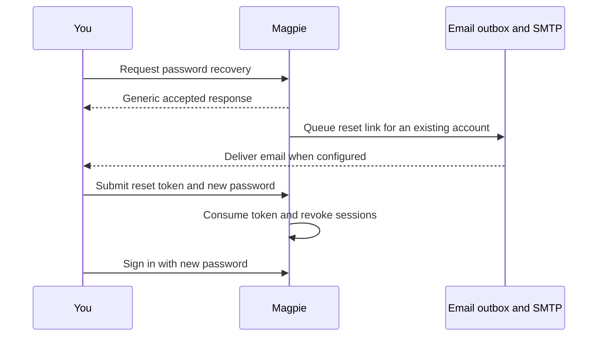

# Account and authentication

Your account is your login identity. A workspace owns operational resources.
Use `/account` for your password, browser accent color, and account deletion;
use `/workspace` for members, roles, and capacity.

## Register and sign in

On a local installation, open the registration page and enter an email address
and a new password. The first account normally becomes the instance
administrator. Production installations disable public registration and
first-admin bootstrap by default; follow [first login](../getting-started/first-login.md)
when setting up a server.

Magpie trims and lowercases email identities. A different capitalization of
your email is not a second account. Registration creates an initial personal
workspace with you as owner and billing administrator.

The password policy requires at least 12 characters, an uppercase letter,
a lowercase letter, a number, and no whitespace. The same policy applies to
registration, password changes, and resets. Example passwords in API docs are
illustrations; choose your own password.

Successful sign-in creates a bearer-token session. Rate limits protect sign-in
and recovery; if you receive `429`, wait for the response's `Retry-After`
period before trying again.

## Change your password

1. Open **Your account** at `/account`.
2. Enter your current password.
3. Enter and repeat the new password. Complete the visible password checklist.
4. Choose **Save password**.
5. Sign in with the new password when your session is no longer accepted.

A successful password change revokes active sessions. If you cannot remember
the current password, use recovery instead of repeatedly guessing it.

## Recover a forgotten password

Open `/forgot-password` from the sign-in page and submit your account email.
The accepted response is deliberately generic so it does not reveal whether
an account exists. It is not proof that an email has arrived.

Reset links expire after 30 minutes by default and can be used once. Requesting
a newer link replaces older outstanding recovery tokens. After a successful
reset, Magpie removes remaining reset tokens and queues a confirmation email.
Session revocation depends on the configured Redis outage policy.

Recovery requires the administrator to configure SMTP and `PUBLIC_APP_URL`.
A `503` can mean recovery is not configured or its durable outbox could not
accept the request. For missing mail or an expired link, use
[password recovery troubleshooting](../operations/troubleshooting.md#password-reset-email-not-arriving).

## Change appearance

Choose an **Accent color** on `/account`. It takes effect immediately and is
saved in this browser. It does not change workspace settings or other members'
preferences. Table-column choices are saved separately per member and workspace.

## Delete your account

Account deletion is permanent and requires your current password. Before doing
it, open every shared workspace you own and transfer ownership to another
member. Magpie returns `409` while you are the sole owner of a shared workspace.

Choose **Delete account**, read the consequences, and enter the current
password in the confirmation dialog. Successful deletion signs you out,
removes your solitary personal workspace, and revokes memberships in other
workspaces. Shared workspaces keep their resources and capacity.

Removing an unwanted proxy is a [managed-proxy action](proxies.md#lifecycle).
Deleting your whole account is not required to clean up a proxy list.

## API equivalents

| Action | Endpoint |
| --- | --- |
| Register or sign in | `POST /api/register`, `POST /api/login` |
| Validate the current token | `GET /api/checkLogin` |
| Rotate or revoke a session | `POST /api/refreshToken`, `POST /api/logout` |
| Request and complete recovery | `POST /api/forgotPassword`, `POST /api/resetPassword` |
| Change password or delete account | `POST /api/changePassword`, `POST /api/deleteAccount` |

See [authentication](../api/authentication.md) for token handling and
[auth and account payloads](../api/rest-auth-and-user.md) for request bodies.
