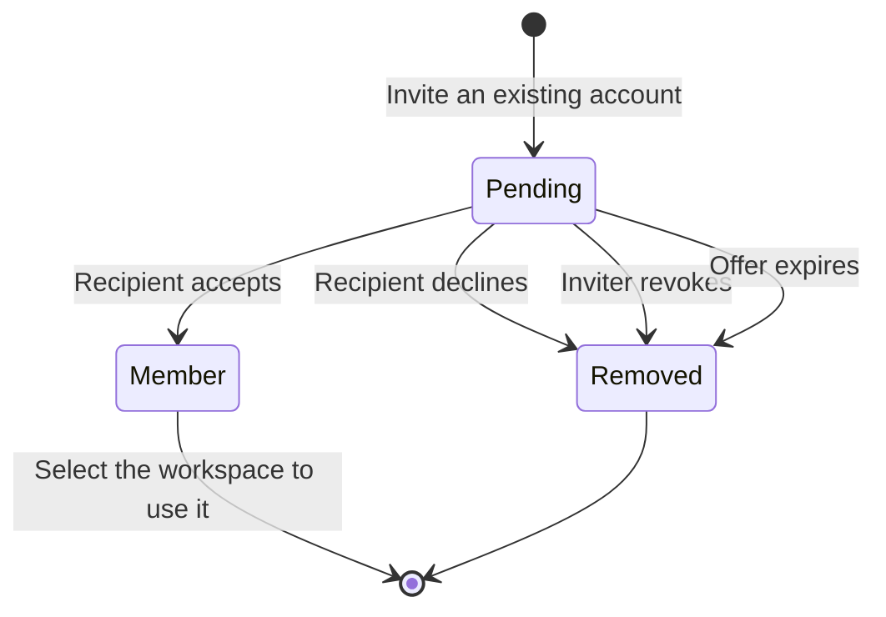

# Workspaces

A workspace is Magpie's resource, collaboration, capacity, and subscription boundary. Every account has at least one workspace. A workspace owns its managed proxies, tags, judges, scrape sources, rotators, operational settings, usage, and subscription.

Membership gives an account access to those resources; it does not make the member an owner of individual proxies or let the member contribute capacity.

## Share your first workspace

Suppose you manage a proxy pool and want a colleague to inspect its health.

1. Ask your colleague to register an account on the same Magpie installation.
2. Select the pool's workspace in the top bar and open **Workspace**.
3. Under **Invite by email**, enter the colleague's account email and choose
   **Viewer**. Send the invitation. Use **Operator** instead if they need to
   import proxies or change the pool's settings.
4. Your colleague opens **Invitations**, reviews the offered role, and selects
   **Accept invitation**.
5. They select **Open workspace** or switch through the top bar. Confirm they
   can see the expected pool.

An invitation is an offer of access. The recipient has no membership until they
accept it. Email helps them notice the offer, but the in-app inbox works without
SMTP.

## Select a workspace

Use the workspace selector in the top bar to change the active workspace. Magpie remembers the selection as your default workspace and reloads workspace-scoped data after the change.

API clients select a workspace with `X-Workspace-ID`. If the header is omitted, Magpie uses the account's default membership. See [Workspace API](../api/rest-workspaces.md).

## Roles

| Role | Read resources | Operate resources | Manage members and workspace | Grant ownership or billing access |
| --- | --- | --- | --- | --- |
| Viewer | Yes | No | No | No |
| Operator | Yes | Yes | No | No |
| Admin | Yes | Yes | Yes | No |
| Owner | Yes | Yes | Yes | Yes |

Operators can import, tag, pause, activate, archive, and delete managed proxies. They can also change workspace settings and manage scrape sources and rotators. Viewers have read-only access. Billing-administrator status is separate from the role and is reserved for future billing operations; only an owner can grant or revoke it.

Owners can manage every role. Admins can invite, edit, and remove operators and viewers, but cannot manage owners, other admins, or billing access. A workspace must always keep at least one owner. Transfer ownership before removing the final owner or deleting an account that is the sole owner of a shared workspace.

Removing a member only revokes access. It does not change the workspace's subscription or capacity, pause routes, or delete infrastructure.

### Transfer ownership safely

An existing owner first promotes another accepted member to **Owner** on the
workspace page and saves the change. Confirm that the new owner can manage
members. The former owner can then be demoted or removed by an authorized
owner. Magpie blocks changes that would leave the workspace without an owner.

Global instance administration is separate from these roles. Being an instance
administrator does not grant membership of every workspace.

## Invitations

Workspace access starts as a pending invitation, not an immediate membership. The recipient must already have a Magpie account, and the invitation is bound to that account. There is no invitation link or bearer token that can be forwarded to another person.

Owners can invite admins, operators, and viewers. Admins can invite operators and viewers. Only owners can include billing access. A workspace can have one pending invitation for each recipient account.

Pending invitations appear in two places:

- Workspace admins and owners see outgoing invitations on `/workspace`, including recipient, inviter, role, billing access, expiry, and notification status. They can edit permitted access or revoke the invitation.
- Recipients see invitations from every workspace on `/invitations`. Accepting creates the membership; declining deletes the invitation.

Accepting does not switch the active workspace or change the account's default workspace. Use **Open workspace** or the top-bar selector when you want to switch.

Invitations expire after seven days by default. Editing an invitation does not renew its expiry. Accepted, declined, revoked, and expired invitations are deleted rather than kept as history.

### Email notifications

If SMTP is configured, Magpie automatically queues an email when an invitation is created and an "invitation changed" email when its role or billing access changes. Users cannot manually resend either message.

Email is only a notification channel. If SMTP is missing or the outbox cannot queue the message, the pending invitation remains available in `/invitations`. No email is sent when an invitation is accepted, declined, revoked, or expires.

## Managed route capacity

One workspace-to-route association is one managed proxy. An active managed proxy consumes one active-route unit exactly once, regardless of who imported it or how many tags, sources, and rotators use it.

Managed proxies have three lifecycle states:

- **Active**: checked and available to rotators; consumes capacity.
- **Paused**: stored, but not checked or available to rotators; does not consume active capacity.
- **Archived**: retained for later recovery, but not checked or available to rotators; does not consume active capacity.

When scrape sources or manual imports exceed a finite capacity limit, Magpie stores the overflow routes as paused with a capacity reason. Activating another route is rejected until capacity is available. A limit change or downgrade never deletes routes; startup reconciliation pauses the newest active overflow routes.

The proxy list and dashboard total include active, paused, and archived proxies. For example, a workspace with a 20,000 active-route limit can store 70,000 scraped proxies, with 20,000 active and 50,000 paused for capacity. Use the workspace page to compare active routes with the limit, or filter the proxy list by lifecycle state.

The workspace page shows active and stored route counts together with the current entitlement snapshot, warns above 80%, and explains when the activation limit has been reached. Self-hosted installations are unlimited by default. If the legacy global proxy limit is enabled, Magpie uses it to seed finite capacity for newly created and migrated workspaces; administrator exclusions still apply when the entitlement is created.

### Capacity example

For a workspace with a limit of 100 active routes:

| Action | Stored routes | Active routes | Capacity outcome |
| --- | ---: | ---: | --- |
| Import 80 new routes | 80 | 80 | All fit. |
| Import 50 more distinct routes | 130 | 100 | The 30 overflow routes remain stored as paused. |
| Pause 10 active routes | 130 | 90 | Ten active-route units become available. |
| Activate 10 paused routes | 130 | 100 | The workspace reaches its limit again. |
| Invite another member | 130 | 100 | Membership does not add capacity. |

Tags and source associations do not multiply the cost of a managed route.
A second workspace managing the same underlying route uses its own capacity.
For the full state transition diagram, see [Proxies](./proxies.md).

## Subscription and usage model

Each workspace has one subscription record and one capacity allowance. The model already separates included capacity, additional capacity, permitted overage, operator seats, check interval, statistics retention, check attempts, and managed traffic usage. Billing-provider integration is intentionally not exposed yet.

Checker attempts are attributed through the existing asynchronous statistics
pipeline. Hosted rotators meter authenticated/accepted requests or tunnel
connections and payload bytes in memory, then flush aggregate deltas to the
monthly workspace usage period. Request handling does not wait for a usage
database write. Payload-byte counters exclude protocol headers and are separate
from active-route capacity.

Members cannot pool personal allowances. When billing is added, capacity purchases and subscription transfers will update the workspace entitlement without changing resource ownership.

`Organization` is reserved for a future billing and identity parent spanning several workspaces. `Team` is reserved for a future permission group inside a workspace.
